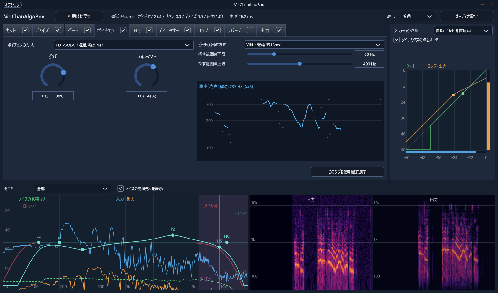

# VoiChanAlgoBox



いろいろなボイスチェンジャーのアルゴリズムを、1つのプラグインの中で切り替えて、聞き比べられるボイスチェンジャーです。

ボイスチェンジャーの仕組みを、実際に音を聞きながら体験して学ぶきっかけになることを目指しています。成人男性の声を女性の声（少女、アニメ声）に変える使い方を想定しています。

| 項目 | 内容 |
|---|---|
| 形式 | VST3 プラグインと、単体で動く EXE 版 |
| 対応 | Windows（64bit） |
| 方式 | ピッチ・フォルマント系（AI を使う変換は対象外） |

各アルゴリズムの仕組みは、図解の [アルゴリズム解説](docs/guide/README.md)（基礎編・ボイチェン編・デノイズ編）にまとめています。

## できること

処理は下の表の順番に流れます。画面には同じ順番でタブが並び、タブの横のチェックでそれぞれオン・オフできます。

| 段 | 内容 | 表示のモード |
|---|---|---|
| カット | ボイチェンの前のローカット・ハイカット | 普通から |
| ノッチ | 細い持続音を自動で追いかけて削る。電源のハム（50 / 60Hz と倍音）を削る | 詳細 |
| リペア | 一瞬だけの音を直す: 音割れの修復、パチパチ（LPC 補間）、吹かれ・破裂音、突発音（キーボードやクリック）、リップノイズ、言葉の合間の息継ぎ。突発音とリップノイズは「下げる / 補間でつなぎ直す」を選べる | 詳細 |
| デノイズ | 定常的なノイズを下げる（下の「デノイズ」） | 簡単から |
| ゲート | ゲート / エキスパンダー（下方）。デノイズの判断した声のありそうさで開くこともできる | 普通から |
| ボイチェン | 声の高さとフォルマントを変える（下の「ボイチェン」） | 簡単から |
| ブレス | 声と同じ声色のささやき声を作り、その高い側を声に足して息っぽさを加える | 詳細 |
| EQ | ローカット・ハイカット、低域と高域のシェルフ、中域のピーク 2 つ | 普通から |
| ディエッサー | サ行などの刺さる音を下げる | 普通から |
| コンプ | 音量の差を小さくする | 普通から |
| リバーブ | リバーブとエコー | 簡単から |
| 出力 | 出力ゲインとリミッター | 簡単から |

### 表示のモード

右上で切り替えます。隠れた機能はオフ、隠れたつまみは初期値として処理します（設定した値は残ります）。

| モード | 出るもの |
|---|---|
| 簡単 | デノイズ・ボイチェン・リバーブ・出力のタブと、声の変わり方を大きく決める項目だけ |
| 普通（初期値） | カット・ゲート・EQ・ディエッサー・コンプのタブも出す |
| 詳細 | ノッチ・リペア・ブレスのタブと、方式ごとの細かいつまみまで全部 |

### 画面

| 部分 | 内容 |
|---|---|
| モニター | 入力と出力のスペクトル（EQ の線をドラッグで操作できる。カット・EQ の特性の線、ディエッサーの帯域、見積もったノイズも重ねて表示）と、入力・出力のスペクトログラム。表示の組み合わせを選べる |
| ダイナミクスのグラフ | 横軸が入力、縦軸が出力。ゲートとコンプ・リミッターの特性の線と、今の音量の点 |
| ボイチェンのグラフ | 検出した声の高さと、フォルマントの動く量 |
| 遅延 | 全体の遅延と、段ごとの内訳、実測の値 |
| 初期値に戻す | 全体を戻すボタンと、表示中のタブだけを戻すボタン |

### ボイチェン

| 分類 | 方式 | 遅延 | 内容 |
|---|---|---|---|
| 時間領域 | ディレイライン式 | 約15ms | リアルタイムで動く早回し |
| | WSOLA 式 | 約20ms | つなぎ目を波形の似た位置に合わせる早回し |
| | TD-PSOLA | 約25ms | 声の 1 周期ごとに切り出して並べ直す。印付けは 波形の重なり / 声門閉鎖点 |
| 周波数領域 | フェーズボコーダ | 約16ms | 周波数成分を移す。位相ロックとフォルマント処理を選べる |
| | 正弦波モデル | 約16ms | 倍音を正弦波で鳴らし直す。雑音成分を別に扱える |
| 周波数シフト | 周波数シフト | 約0ms | 全部の周波数を同じ Hz だけずらす（ピッチシフトとの違いを聞くため） |
| | 帯域ごとの周波数シフト | 約1ms | 帯域ごとに中心周波数に比例した量だけずらす |
| 声色と声帯の音に分ける | LPC＋ディレイライン、ケプストラム＋ディレイライン、メルケプ＋ディレイライン | 約15ms | 声を「声帯の音」と「口と喉のフィルタ」に分けて、声帯の音だけ高さを変える |
| | LPC＋PSOLA、ケプストラム＋PSOLA、メルケプ＋PSOLA | 約25ms | 同じく、声帯の音を PSOLA で変える |
| ボコーダ | チャンネルボコーダ | 約5ms | 帯域ごとの大きさを、のこぎり波と雑音の音源に乗せる |
| | LPC ボコーダ、ケプストラムボコーダ、メルケプボコーダ | 約16ms | 声色を取り、声帯の音はパルス列と雑音で作り直す |
| 分析合成 | WORLD | 約84ms | 声を高さ・声色・かすれに分解して作り直す。遅延は大きいが高品質。声の高さは DIO か Harvest で求める |

声色の求め方の「メルケプ」は、周波数の軸を耳の感じ方に合わせて曲げたメルケプストラムと、MLSA フィルタを使うものです（日本の音声合成の定番）。ボコーダの 4 方式は、音源を帯域ごとに倍音と雑音で混ぜる「混合励振」と、声帯の波形（パルス列 / Rosenberg / LF）を選べます。

**フォルマントの動かし方**

| 動かし方 | 内容 |
|---|---|
| 一律 | すべての周波数を、同じ倍率で動かす |
| 低い側を残す | 1kHz より上は一律、そこから下は低いほど動かさず、150Hz 以下は動かさない。声が細くなりにくい |
| 帯域ごと | 固定の目印ごとに差を決めて動かす（グラフの点） |
| フォルマントごと | 声から F1・F2・F3 を追いかけて、それぞれ別の量だけ動かす |

**ピッチ検出**（PSOLA の 4 方式とボコーダの 4 方式で使う。WORLD は DIO か Harvest）

| 方式 | 内容 |
|---|---|
| 自己相関 | 一番シンプル。1 オクターブ低く間違えやすい |
| YIN | ピッチ検出の定番。間違いが少ない |
| pYIN | YIN の候補から確率で選ぶ（10ms 先を見る） |
| McLeod（MPM） | YIN と並ぶ定番。間違いが少ない |
| RAPT | 候補から前後のつながりで選ぶ（10ms 先を見る） |
| ケプストラム法 | 倍音の等間隔な並びから周期を探す |
| SWIPE | 精度が高いが窓が長く、遅延が増えやすい |
| SIFT | LPC で声道の影響を除いてから探す、古典的な方法 |
| DIO | WORLD の速い方法。遅延が約 60ms 増える |
| Harvest | WORLD の正確な方法。遅延が約 80ms 増える |

抑揚の強調: 最近 2 秒ほどの声の高さの平均からのずれを広げます（ピッチ検出を使う方式）。

### デノイズ

| 分類 | 方式 | 遅延 | 内容 |
|---|---|---|---|
| 帯域分割 | 帯域分割式 | 0ms | 20 の帯域ごとに下げる（ゲート式 / エキスパンダー式 / SNR 式） |
| | くし形フィルタ＋帯域分割 | 0ms | 声の高さに合わせて、さらに倍音の間も下げる |
| FFT | FFT | 窓 512 で約11ms | 細かく下げられるが、窓の分だけ遅れる |
| | FFT＋FIR | 0ms | FFT で決めた量から作った最小位相の FIR フィルタを今の音にかける |
| | FFT＋帯域分割 | 0ms | FFT で決めた量を 32 帯域にまとめて今の音にかける。立ち上がりの保護つき |
| | WebRTC NS | 約17ms | ビデオ通話などで使われるノイズ抑制（AI ではない）。必要なファイルだけを external/webrtc_ns に抜き出して組み込み |
| | WebRTC NS＋帯域分割 | 0ms | WebRTC NS の量を帯域でかける |
| AI | RNNoise | 約30ms | AI が下げる量を決める |
| | RNNoise＋帯域分割 | 0ms | AI の量を帯域でかける。語頭は遅れ気味 |
| | DeepFilterNet | 約40ms | AI が細かく下げる。標準 / 低遅延のモデルと、後段のフィルタを選べる |
| | DeepFilterNet＋帯域分割 | 0ms | AI の量を帯域でかける。語頭は遅れ気味 |

**FFT の下げる量の決め方**（違いが小さいので、詳細の表示だけに出す）

| 決め方 | 内容 |
|---|---|
| スペクトル減算 | 一番素朴。ピロピロした音（ミュージカルノイズ）が出る |
| ウィーナー | 判定指向型で、ピロピロしない |
| MMSE-STSA | ウィーナーより控えめに下げ、声を傷めにくい |
| log-MMSE（初期値） | MMSE-STSA と同じく控えめ。大きさを対数で考えた形 |
| ウィーナー＋倍音の再生（HRNR） | ウィーナーの後、細った倍音を作り直す |
| ウィーナー＋倍音の保護 | 検出した倍音の位置だけ、下げる量をゆるめる |
| 過剰減算（Berouti） | SNR が低いフレームほど多めに引き、ピロピロを減らす |
| 帯域ごとの減算（Kamath-Loizou） | 過剰減算を、4 つの帯域ごとに行う |
| ウィーナー＋2 段階（TSNR） | ウィーナーの結果から SNR を求め直し、語頭の欠けを取り戻す |
| 聴覚のマスキング（Virag） | 声に隠れて聞こえないノイズは残し、声を傷めない |

**FFT の調整**

| 項目 | 選択肢 |
|---|---|
| ならし方 | なし / 時間 / 周波数 / ケプストラム（ピロピロ音を減らす） |
| 声のありそうさで調整 | オフ / 半々で固定 / 自動（Cohen）（OM-LSA の考え方） |
| 残ったノイズの音色をそろえる | コンフォートノイズ |

**ノイズの見積もり**（見積もったノイズはモニターに線で重ねて表示。残響の抑制もできる）

| 見積もり | 内容 |
|---|---|
| 自動（最小値） | 直近の「最小値を探す長さ」（初期値 1.6 秒）の、一番静かなところを見る。話し続けると、声をノイズと取り違えて削ることがある |
| 自動（音量の判定）（初期値） | 全体の音量が、見積もりより「判定のしきい値」以上大きければ声とみなし、声のない間だけ更新する。しきい値を超えるほどノイズが大きくなったら、しきい値を上げて合わせ直す |
| 自動（Gerkmann の声の推定） | 区画ごとに声がある確率を求め（統計モデル）、声がなさそうな区画だけ更新する。確率の出し方は「声の SNR の仮定」で変えられる |
| 自動（RNNoise の声の判定） | RNNoise が「声なし」と判定した間だけ更新する（区切りは「声とみなす確率」）。話し続けても声を削りにくい |
| 学習 | ボタンを押して 2 秒黙っている間のノイズを覚え、その値で下げる（保存できる） |
| 学習＋自動（音量の判定 / Gerkmann の声の推定 / RNNoise の声の判定） | 学習した値から始めて、その後はそれぞれの方法で追う |

## 使うときの注意

**ヘッドフォンで使ってください。** スピーカーで鳴らすと、出た音をマイクが拾って、ハウリング（キーンという大きな音）が起きることがあります。EXE 版は、起動してすぐ音が出るように、入力のミュートを初めからオフにしています。

EXE 版の初回は、左上の「オプション」→「オーディオ設定...」から、入力と出力のデバイスを選んでください。マイクの入力チャンネル（1ch / 2ch）は、自動で音が来ているほうを選びます。

## EXE 版を初めて起動するとき

署名をしていないので、ダウンロードした EXE を初めて実行すると、Windows の「PC が保護されました」という青い画面が出ます。次のどちらかで実行できます。

- 「詳細情報」を押してから「実行」を押す
- 実行する前に、EXE（または ZIP）を右クリック → プロパティ → 下のほうの「許可する」にチェック → OK

一度実行すれば、同じファイルでは次から出ません。

## ビルド

必要なもの: Visual Studio 2022（C++ によるデスクトップ開発）、CMake 3.22 以上、Git、Rust（https://rustup.rs 。DeepFilterNet を組み込むため。なくてもビルドできるが、その場合 DeepFilterNet は素通しになる）

```
git clone --recursive https://github.com/xelloss120/VoiChanAlgoBox.git
cd VoiChanAlgoBox
cmake -S . -B build -G "Visual Studio 17 2022" -A x64
cmake --build build --config Release
```

- `C:\src` のような浅い場所に置いてください。深い場所だと、Windows のパスの長さの制限で、clone やサブモジュールの取得が失敗することがあります。
- `--recursive` を付けずに clone したときは、`git submodule update --init --recursive` でサブモジュールを取得します。
- CMake は、Visual Studio に同梱のものも使えます（「Developer PowerShell for VS 2022」から実行すると、`cmake` コマンドが使えます）。

初回の `cmake -S ...` のときに、RNNoise の学習済みの重み（約 58MB）を公式の配布元（media.xiph.org）から、DeepFilterNet の低遅延のモデル（約 36MB）を DeepFilterNet のリポジトリから取得し、SHA-256 を照合してから使います。インターネットにつながった状態で実行してください。同じときに、DeepFilterNet のラッパー（`Source/DeepFilter`、Rust）も、依存するライブラリを取得してビルドします（初回は数分かかります）。Rust を入れずにビルドするときは、`cmake -S . -B build -DVCAB_DEEPFILTER=OFF` とします。

できるもの:

| ファイル | 内容 |
|---|---|
| `build/VoiChanAlgoBox_artefacts/Release/VST3/VoiChanAlgoBox.vst3` | VST3 プラグイン（フォルダ。フォルダごとコピーして使う） |
| `build/VoiChanAlgoBox_artefacts/Release/Standalone/VoiChanAlgoBox.exe` | EXE 版 |
| `build/vcab_render_artefacts/Release/vcab_render.exe` | 開発用の WAV 処理ツール |

## 開発用の WAV 処理ツール（vcab_render）

WAV ファイルに、プラグインと同じ処理をかけて書き出します。同じ録音で全方式を聞き比べるときに使います。

```
vcab_render --in voice.wav --out out.wav --set pitch=12 --set formant=0
vcab_render --in voice.wav --outdir results --all
vcab_render --gen sine:200 --dur 2 --out test.wav --set pitch=12
vcab_render --list
```

`Tools/Regression` に、処理の音がビット単位で変わっていないかを確かめる回帰テストと、デノイズの効き方を測るツールがあります（使い方はそのフォルダの README）。

## ライセンス

Copyright (C) 2026 x120

[AGPLv3](LICENSE)（AGPL-3.0-only）。使っているライブラリのライセンスは [THIRD_PARTY_LICENSES.md](THIRD_PARTY_LICENSES.md) と [THIRD_PARTY_LICENSES_RUST.md](THIRD_PARTY_LICENSES_RUST.md) にまとめています。ASIO SDK を GPLv3 で使っているため、GPLv3 の本文を [LICENSES/GPL-3.0.txt](LICENSES/GPL-3.0.txt) に置いています。

VST is a trademark of Steinberg Media Technologies GmbH, registered in Europe and other countries.
