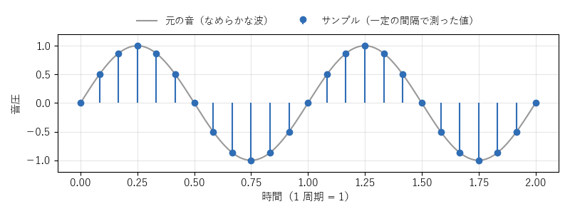

[目次](../README.md) ｜ 次: [周波数とスペクトル](02-spectrum.md)

# 音とデジタル

## 音は空気の圧力の波

音は、空気の圧力が細かく上がったり下がったりして伝わる波です。マイクはこの圧力の変化を電気の信号に変えます。横軸に時間、縦軸に圧力をとって描いたものが**波形**です。

1 秒間に何回くり返すかを**周波数**（Hz）と呼びます。くり返しが速い（周波数が高い）ほど高い音に聞こえます。人の耳に聞こえるのは、だいたい 20Hz〜20kHz です。

## サンプリング: 波を数値の並びにする

コンピュータは連続した波をそのまま扱えないので、一定の間隔で波の高さを測って、数値の並びにします。これを**サンプリング**、1 つ 1 つの数値を**サンプル**と呼びます。

1 秒間に測る回数が**サンプルレート**です。VoiChanAlgoBox は 44.1kHz と 48kHz に対応しています。48kHz なら、1 秒の音は 48,000 個の数値になります。

サンプルレートの半分（48kHz なら 24kHz）より高い音は、正しく表せません（**ナイキスト周波数**）。それより高い音が混ざると、別の低い音に化けて聞こえます（**折り返し**、エイリアシング）。ボコーダで音源を作るときなど、音を新しく作る処理では、この折り返しを出さない工夫が要ります。

## dB（デシベル）: 大きさを比で表す

音の大きさは、とても小さい音から大きい音まで幅が広いので、比を対数で表す **dB** を使います。

| dB の差 | 大きさ（振幅）の比 |
|---|---|
| +6dB | 約 2 倍 |
| +20dB | 10 倍 |
| -6dB | 約半分 |
| -20dB | 1/10 |
| -60dB | 1/1000 |

デジタルの音では、表せる一番大きな値を 0dB とし、それより小さい音をマイナスで表します（**dBFS**）。VoiChanAlgoBox の画面の数値も、多くはこの dBFS です。「ノイズを 24dB 下げる」は、ノイズの振幅を約 1/16 にすることです。

## 少しずつ処理する

リアルタイムのボイスチェンジャーは、録音が終わるのを待たずに、マイクから来た音を少しずつ処理して、すぐに返します。オーディオインターフェースは、たとえば 128 サンプル（48kHz で約 2.7ms）ごとに音を渡してきます。この一塊を**ブロック**（バッファ）と呼びます。

ブロックの処理は、次のブロックが来る前に必ず終わらせなければなりません。間に合わないと、音が途切れてブツブツという雑音になります。そのため、重い計算を一度にまとめて行う方式（WORLD など）は、別のスレッドで計算するなどの工夫をしています。

処理によっては、少し先の音を見てからでないと決められないことがあります（声の 1 周期の長さを測る、など）。その分だけ、出てくる音が遅れます。遅れについては [遅延](07-latency.md) で詳しく説明します。

## 聞きどころ

- 画面の上の遅延の表示（「遅延 26.4 ms（ボイチェン 25.4 / …）」）は、処理そのものの遅れです。オーディオインターフェースのブロックの分は含みません。
- EXE 版の「オーディオ設定」でバッファの大きさを小さくすると、全体の遅れは減りますが、重い方式では途切れやすくなります。
