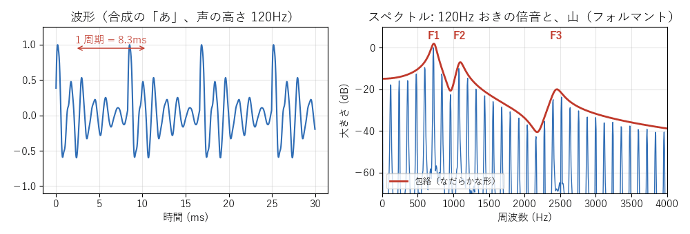
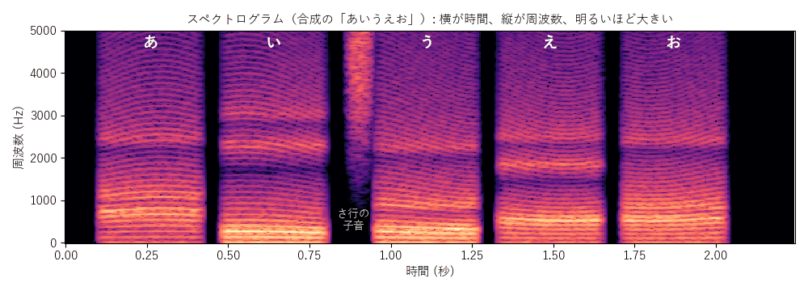
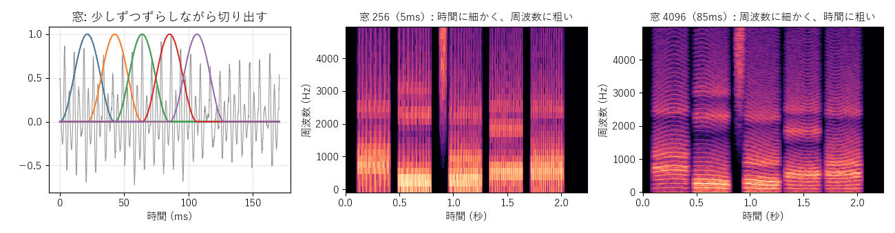

[目次](../README.md) ｜ 前: [音とデジタル](01-sound.md) ｜ 次: [声の仕組み](03-voice.md)

# 周波数とスペクトル

## どんな音も、正弦波の足し算

どんなに複雑な波形でも、いろいろな周波数の正弦波（なめらかな「サイン波」）を、それぞれの大きさとタイミング（**位相**）で足し合わせたものとして表せます。音を「どの周波数が、どれだけの大きさで含まれているか」に分けたものが**スペクトル**です。

左は「あ」の波形、右はそのスペクトルです。波形は 8.3ms ごとに同じ形をくり返しています（1 秒に 120 回 = 120Hz）。スペクトルでは、120Hz とその整数倍（240Hz、360Hz…）に細い山が並んでいます。この細い山を**倍音**と呼びます。倍音の大きさをなだらかにつないだ線（赤）を**包絡**と呼び、その山（F1、F2…）が声色を決めます（[声の仕組み](03-voice.md)）。

## フーリエ変換と FFT

波形からスペクトルを求める計算が**フーリエ変換**です。コンピュータでは、決まった数（256、512、1024 など 2 のべき乗）のサンプルをまとめて、速く計算できる **FFT**（高速フーリエ変換）を使います。逆の計算（**逆 FFT**）で、スペクトルから波形に戻すこともできます。

FFT の結果は、等間隔の周波数ごとの値の並びです。この 1 つ 1 つを**ビン**（区画）と呼びます。48kHz で 1024 点の FFT なら、ビンの間隔は 48000 ÷ 1024 ≒ 47Hz です。

## 窓: 少しずつ切り出す

声は時間とともに変わるので、短い区間ずつ切り出して FFT します。切り出すときは、端がなめらかに 0 になる山形の**窓**（ハン窓など）をかけます。四角く切ると、端の段差が余計な周波数として現れてしまうためです。

窓は少しずつ（たとえば窓の長さの 1/4 ずつ）ずらしながら重ねて切り出します。処理した後は、重ねて足して元の長さの波形に戻します（**重ね合わせ加算**、オーバーラップ・アド）。

## スペクトログラム

切り出した区間ごとのスペクトルを、時間の順に並べて色の濃さで描いたものが**スペクトログラム**です。横軸が時間、縦軸が周波数、明るいほどその周波数の音が大きいことを表します。

横に伸びる細い線の並びが倍音です。母音が変わると、明るい帯（フォルマント）の位置が変わります。「う」の前の縦に広がった部分は、サ行の子音のような息の音です。息の音には倍音がなく、広い範囲に広がります。

VoiChanAlgoBox の画面下のモニターにも、入力と出力のスペクトルとスペクトログラムが出ます。

## 時間の細かさと周波数の細かさは両立しない

窓を短くすると、時間の変化は細かく追えますが、周波数は粗くしか分かりません。窓を長くすると、その逆です。

窓 256（約 5ms）では倍音の線が見えず、窓 4096（約 85ms）では倍音がくっきり見える代わりに、母音の切り替わりがぼやけています。

この釣り合いは、ボイチェンとデノイズのあちこちに現れます。

- 低い声の倍音を分けて見るには、長い窓が要ります。
- 長い窓は、その分だけ音を遅らせます（[遅延](07-latency.md)）。
- 長い窓は、声の出だし（語頭）のような速い変化に遅れます。

フェーズボコーダや FFT のデノイズで「FFT の窓の長さ」を選べるのは、この釣り合いを聞き比べるためです。

## 聞きどころ

- モニターの表示を「全部」にして声を出すと、倍音の線とフォルマントの帯が見えます。「あ」「い」「う」と母音を変えて、帯が動く様子を見てみてください。
- ピッチを上げると倍音の間隔が広がり、フォルマントを上げると帯が上に動きます（出力のスペクトログラム）。
