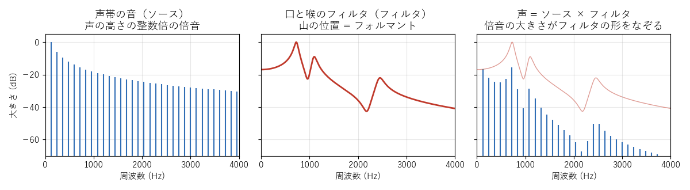
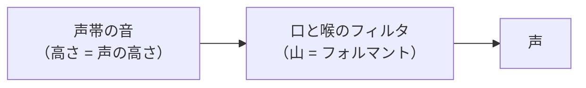

[目次](../README.md) ｜ 前: [周波数とスペクトル](02-spectrum.md) ｜ 次: [ピッチとフォルマント](04-pitch-and-formant.md)

# 声の仕組み

## 声帯の音と、口と喉のフィルタ

声は、大きく 2 つの部分でできていると考えられます。

1. **声帯の音（ソース、音源）**: 肺からの息で声帯が震え、空気を細かく区切って「ブー」というブザーのような音を作ります。震える速さが声の高さです。
2. **口と喉のフィルタ（声道）**: 声帯の音が、喉・口・鼻の空間を通るときに、特定の周波数が響いて強まります。舌や唇の形でこの響き方が変わり、「あ」「い」「う」の違いになります。

この考え方を**ソース・フィルタモデル**と呼びます。多くのボイスチェンジャーの方式は、このモデルに沿って作られています。

- **左**: 声帯の音は、声の高さ（この図では 120Hz）の整数倍の倍音でできています。高い倍音ほど小さくなります。
- **中**: 口と喉のフィルタには、いくつかの山があります。この山を**フォルマント**と呼び、低い方から F1、F2、F3… と数えます。
- **右**: 声は、声帯の音の倍音の大きさが、フィルタの形で変わったものです。倍音の頭をつなぐと、フィルタの形が浮かび上がります。

## 声の高さ（ピッチ）

声帯が 1 秒に震える回数が、声の高さ（**基本周波数**、F0）です。一般に、成人男性の話し声は 100〜150Hz 前後、成人女性は 200〜300Hz 前後と言われます。声の高さを音楽の単位で表すときは**半音**を使います。12 半音（1 オクターブ）上がると、周波数は 2 倍になります。

| 半音 | 周波数の倍率 |
|---|---|
| +12 | 2.00 倍 |
| +7 | 1.50 倍 |
| +6 | 1.41 倍 |
| +5 | 1.33 倍 |
| -12 | 0.50 倍 |

## 声色（フォルマント）

フォルマントの位置は、母音の種類と、声道の長さで決まります。母音ごとのおおよその位置（男声）は次のとおりです。

| 母音 | F1 | F2 |
|---|---|---|
| あ | 約 700Hz | 約 1100Hz |
| い | 約 300Hz | 約 2300Hz |
| う | 約 300Hz | 約 1300Hz |
| え | 約 500Hz | 約 1900Hz |
| お | 約 500Hz | 約 850Hz |

声道が短いほど、すべてのフォルマントが高くなります。一般に女性や子どもは男性より声道が短く、同じ母音でもフォルマントが 1〜2 割ほど高めです。

## 有声音と無声音

母音や「ん」のように声帯が震えている音を**有声音**、「さ」「し」の子音や息のように声帯が震えていない音を**無声音**と呼びます。

- **有声音**: 倍音がきれいに並びます。声の高さがあります。
- **無声音**: 雑音のように広い範囲に広がり、倍音がありません。声の高さもありません。

多くのボイチェンの方式は、声の 1 周期を基準に処理します。そのため、無声音の区間では別の扱いに切り替える必要があります。ピッチ検出は、声の高さと一緒に「有声か無声か」も判定します（[ピッチ検出](06-pitch-detection.md)）。

## 聞きどころ

- ボイチェンのタブの右側のグラフ（声の高さ）を見ながら話すと、声の高さが文の中で上下している様子と、無声音で線が途切れる様子が見えます。
- 声の高さを一定に保ったまま「あいうえお」と言い、モニターのスペクトログラムでフォルマントの帯の動きを見てください。
