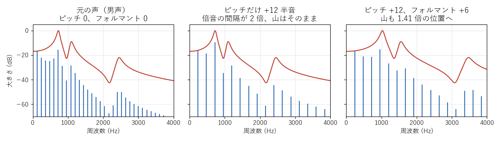

[目次](../README.md) ｜ 前: [声の仕組み](03-voice.md) ｜ 次: [声色の形（包絡）の求め方](05-envelope.md)

# ピッチとフォルマント

## 男声を女声にするには、2 つを変える

男声と女声の違いは、主に次の 2 つです。

1. **声の高さ（ピッチ）**: 女声は男声より 1 オクターブ前後高い。
2. **声色（フォルマント）**: 女声は声道が短いので、フォルマントが少し高い。

声の高さだけを上げると、声色は男性のまま高い声になり、「裏声の男性」のように聞こえがちです。声色だけを上げると、低い声のまま声道が短い感じになります。女声らしく聞かせるには、両方を適切な量だけ変える必要があります。

- **左**: 元の声。120Hz おきの倍音と、フォルマントの山（赤い線）。
- **中**: ピッチだけ +12 半音。倍音の間隔が 2 倍の 240Hz になりますが、赤い線（声色）はそのままです。
- **右**: ピッチ +12、フォルマント +6 半音。倍音の間隔が 2 倍になり、さらに赤い線も 1.41 倍の位置へ動いています。

VoiChanAlgoBox の初期値は、ピッチ +12、フォルマント +6 です。フォルマントは、ピッチほど大きく動かさないのが一般的です。フォルマントを上げすぎると、声が小さな子どもや、早回しの声のように聞こえます。

## ピッチとフォルマントは別々の量

VoiChanAlgoBox では、ピッチもフォルマントも「入力の声を基準に、何半音動かすか」で指定します（-24〜+24 半音）。表示は `+12 (+100%)` のように、半音と変化率の両方を出します。

- ピッチ +12、フォルマント 0 なら、声の高さだけが 2 倍になり、声色はそのまま。
- ピッチ 0、フォルマント +6 なら、声の高さはそのままで、声色だけが 1.41 倍の位置へ。

## 一番簡単な方法では、2 つが一緒に動く

録音したテープを速く回すと、声が高くなり、同時に声色も高くなります（早回しの声）。これは、時間を縮めると、倍音の間隔もフォルマントの山も、すべての周波数が同じ倍率で上がるからです。

この「一緒に動いてしまう」方式では、フォルマントを別に動かせません。VoiChanAlgoBox では、ディレイライン式、WSOLA 式、周波数シフト、フォルマント処理を「なし」にした方式がこれにあたり、フォルマントのつまみが灰色になります。

ピッチとフォルマントを別々に動かすには、声を「声帯の音（ピッチ）」と「フィルタ（声色）」に分けて扱う必要があります。方式ごとに、この分け方が違います。

| 分け方 | 方式 |
|---|---|
| 1 周期ずつ切り出し、断片の形を保ったまま並べ直す | TD-PSOLA |
| スペクトルの包絡（声色）を取り出して、倍音とは別に動かす | フェーズボコーダ、正弦波モデル、帯域ごとの周波数シフト |
| 声を「声帯の音」と「フィルタ」に分解する | LPC・ケプストラム・メルケプの各方式、ボコーダ、WORLD |

## 聞きどころ

- フォルマントを 0 にしてピッチだけ +12 にすると、男性の声色のまま高くなります。そこからフォルマントを +3、+6、+9 と上げて、どこで女声らしく聞こえるか、どこから子どもっぽくなるかを聞き比べてください。
- ディレイライン式を選ぶと、フォルマントのつまみが灰色になります。ピッチを上げると、早回しの声になります。
