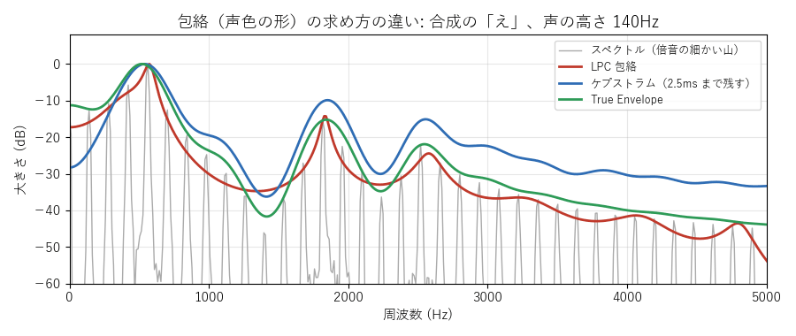
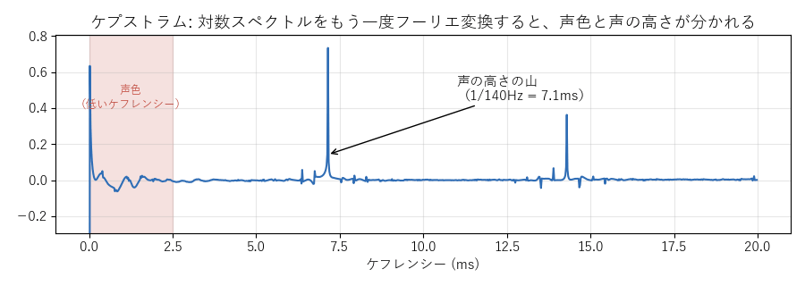
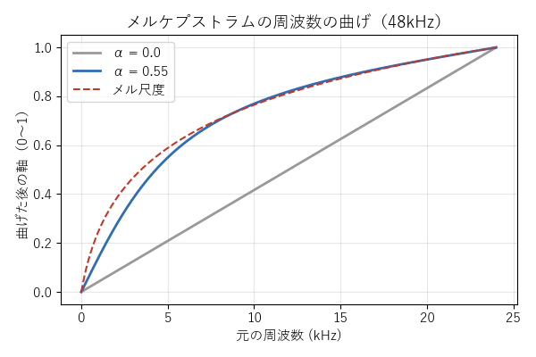

[目次](../README.md) ｜ 前: [ピッチとフォルマント](04-pitch-and-formant.md) ｜ 次: [ピッチ検出](06-pitch-detection.md)

# 声色の形（包絡）の求め方

フォルマントを動かすには、まず声のスペクトルから、倍音の細かい山をならした「なだらかな形」（**スペクトル包絡**）を取り出す必要があります。VoiChanAlgoBox では、方式によって次の 4 つの求め方を使い分けています。

灰色の細い山が倍音、色の線がそれぞれの方法で求めた包絡です（どれも一番高いところを 0dB にそろえています）。

| 求め方 | 特徴 | 使う方式 |
|---|---|---|
| LPC | 山が鋭く、谷は浅い。少ない数（次数）で表せる | LPC の 3 方式、フェーズボコーダなどのフォルマント処理「LPC 包絡」 |
| ケプストラム | なだらか。山の頂点より低めに、倍音の間の谷も平均してしまう | ケプストラムの 3 方式、フォルマント処理「ケプストラム」 |
| True Envelope | 倍音の頂点をなぞる | フォルマント処理「True Envelope」（フェーズボコーダと正弦波モデルの初期値） |
| メルケプストラム | 低い周波数を細かく、高い周波数を粗く表す | メルケプの 3 方式 |

## LPC（線形予測）

**LPC**（線形予測符号化）は、「今のサンプルは、直前のいくつかのサンプルの重み付きの和でだいたい予測できる」という考え方です。声道は共鳴する管なので、その出力の波形は、少し前の値からよく予測できます。

予測に使う重み（**LPC の係数**）が、そのまま声道のフィルタ（山だけでできた**全極型**のフィルタ）になります。予測しきれなかった残り（**残差**）は、ほぼ声帯のパルスです（[声色と声帯の音に分ける方式](../voice/06-source-filter.md) の図）。

- **次数**: 直前の何サンプルを使うか。次数が多いほど細かい形を表せますが、多すぎると倍音 1 本 1 本までなぞってしまいます。VoiChanAlgoBox の初期値は 28（48kHz）。
- LPC は山を鋭く表すのが得意で、谷を表すのは苦手です。
- VoiChanAlgoBox の LPC の方式には、音質の定番の対策が入っています（初期値はすべてオン）。
  - **帯域拡張**: 山を少しなだらかにして、鋭すぎる響きを抑える
  - **係数補間**: 5ms ごとの係数の切り替わりをなめらかにつなぐ
  - **高域強調**: 高い音を持ち上げてから分析し、高い側の形も捉えやすくする

## ケプストラム

**ケプストラム**は、スペクトルの大きさの対数を、もう一度フーリエ変換したものです。

対数スペクトルの中で、なだらかに変わる部分（声色）はケプストラムの左端（低い**ケフレンシー**）に集まります。細かく等間隔に並ぶ倍音は、声の周期（この図では 7.1ms）の位置の山になります。声色と声の高さが、ケプストラムの上ではきれいに分かれます。

そこで、左端の部分（VoiChanAlgoBox では 2.5ms まで）だけを残してスペクトルに戻すと、なだらかな包絡が得られます。同じケプストラムの山の位置から、声の高さも求められます（ピッチ検出の「ケプストラム法」）。

ケプストラムで求めた包絡は、倍音の頂点と谷の平均をとるので、頂点より低めになり、山も鈍くなります。

## True Envelope

**True Envelope** は、ケプストラムの改良版です。ケプストラムでならした線が倍音の頂点より下にあるところを、頂点まで持ち上げて、もう一度ならす、をくり返します。最後には、倍音の頂点をなぞる包絡になります。計算は増えますが、フォルマントの山の高さを正しく保てます。

## メルケプストラム

人の耳は、低い音の違いには敏感で、高い音の違いには鈍感です。この感じ方に合わせた周波数の目盛りが**メル尺度**です。

**メルケプストラム**は、周波数の軸をメル尺度に近く曲げてから、ケプストラムを求めます。同じ数の係数で、低い周波数を細かく、高い周波数を粗く表せます。日本の音声合成（SPTK、HTS など）で定番の表し方です。

軸の曲げ方は、1 次の全域通過フィルタで作ります。曲げの強さ α は、メル尺度に一番近くなる値を選びます（48kHz で約 0.55）。メルケプストラムから声を作り直すときは、**MLSA フィルタ**（メル対数スペクトル近似フィルタ）を使います。

## 聞きどころ

- フェーズボコーダか正弦波モデルを選び、「フォルマント処理」を ケプストラム / LPC 包絡 / True Envelope と切り替えて、フォルマント +6 のときの声色の違いを聞いてください。
- LPC＋PSOLA、ケプストラム＋PSOLA、メルケプ＋PSOLA は、包絡の求め方だけが違う 3 つ組です。
