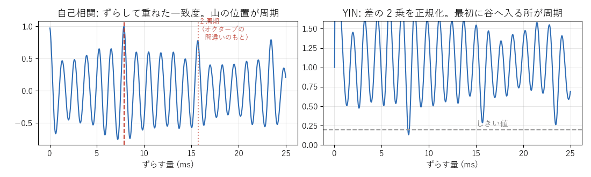

[目次](../README.md) ｜ 前: [声色の形（包絡）の求め方](05-envelope.md) ｜ 次: [遅延](07-latency.md)

# ピッチ検出

声の 1 周期ごとに処理する方式（TD-PSOLA など）や、声帯の音を作り直す方式（ボコーダ）は、今の声の高さを知る必要があります。声の高さを見つけることを**ピッチ検出**と呼びます。

VoiChanAlgoBox では、次の方式で使います。

- PSOLA の 4 方式: TD-PSOLA、LPC＋PSOLA、ケプストラム＋PSOLA、メルケプ＋PSOLA
- ボコーダの 4 方式: チャンネルボコーダ、LPC ボコーダ、ケプストラムボコーダ、メルケプボコーダ
- デノイズのくし形フィルタと倍音の保護

WORLD は、自身の DIO か Harvest を使います。

## 基本の考え方: ずらして重ねる

声の波形は、1 周期ごとにほぼ同じ形をくり返します。そこで、波形を少しずつずらして元の波形と重ね、一番よく重なるずらし量を探せば、それが周期です。

- **左の自己相関**: ずらして掛け合わせた和です。周期（約 8ms）で山になります。ただし、2 周期（16ms）でも同じくらいの山になるため、1 オクターブ低く間違えることがあります（**オクターブの誤り**）。
- **右の YIN**: 自己相関を改良したものです。ずらしたときの差の 2 乗を正規化し、しきい値より下の谷のうち最初のものを周期とします。オクターブの誤りが少なくなります。

## 探す範囲

声の高さを探す範囲（初期値 80〜400Hz）は、ボイチェンのタブで変えられます。

- **下限を下げる**: 低い声の周期を見るには、少なくとも 2 周期分の音が要ります。下限 80Hz なら約 25ms 分の窓が要り、その分だけ遅延が増えます。
- **範囲を広げる**: オクターブの誤りが起きやすくなります。

## 10 の方式

| 方式 | 仕組み | 特徴 |
|---|---|---|
| 自己相関 | ずらして重ねた一致度の山 | 一番シンプル。1 オクターブ低く間違えやすい |
| YIN | 差の 2 乗を正規化し、最初の深い谷 | ピッチ検出の定番。間違いが少ない |
| pYIN | YIN の谷を、しきい値を変えながら確率付きの候補に残し、前後のつながりが一番もっともらしい並びを選ぶ（隠れマルコフモデル） | 10ms 先まで見てから決める。雑音に強い |
| McLeod（MPM） | 正規化した相関の山のうち、最大に近い最初の山 | YIN と並ぶ定番。短い窓でも安定しやすい |
| RAPT | 相関の山を候補に残し、前後のフレームとのつながりで選ぶ（動的計画法） | 有声・無声の判断もつながりで決める。雑音に強い |
| ケプストラム法 | ケプストラムの声の高さの山（[包絡の求め方](05-envelope.md)） | 声色と同じ計算から求まる。窓が短いと低い声を見逃しやすい |
| SWIPE | 倍音の位置に歯がある「くし」とスペクトルの重なり | 精度が高いが、窓が長く遅延が増える |
| SIFT | LPC で声道の影響を取り除いた残差の自己相関 | LPC を使う古典的な方法 |
| DIO | WORLD の速い方法。0 を横切る間隔から求める | 遅延が約 60ms 増える |
| Harvest | WORLD の正確な方法。候補を磨いてつなぐ | 有声・無声の判断が正確。遅延が約 80ms 増える |

選択欄の各方式には、遅延の目安（探す範囲の下限が 80Hz のときの、検出そのものの遅れ）が添えてあります。遅れの大きい方式を選ぶと、ボイチェンの遅延もその分だけ増えます。

## 有声・無声の判定

ピッチ検出は、声の高さと一緒に、今の音が有声音か無声音かも判定します。無声音（子音や息）の区間では、TD-PSOLA は周期に合わせた切り出しをやめ、ボコーダは音源をパルス列から雑音に切り替えます。

## 聞きどころ

- ボイチェンのタブの声の高さのグラフでは、有声音は色付きの線、無声音は灰色の点で表示されます。方式を切り替えて、線が途切れたり、急に半分の高さへ飛んだり（オクターブの誤り）しないかを見比べてください。
- TD-PSOLA で、ピッチ検出を自己相関にして低い声で話すと、オクターブの誤りで声が不安定になる瞬間があります。YIN や RAPT に戻すと安定します。
- 遅延の表示を見ながら、ピッチ検出の方式（SWIPE、DIO、Harvest）や探す範囲の下限を変えると、遅延が変わります。
