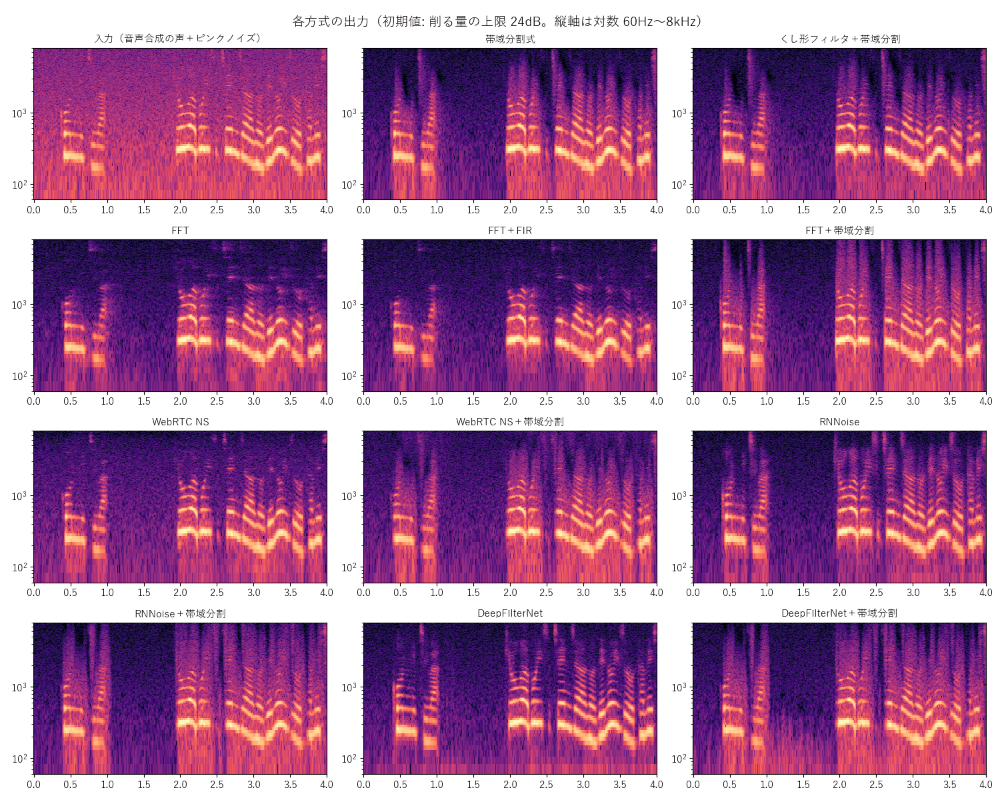

[目次](../README.md) ｜ 前: [フォルマントの動かし方と抑揚](../voice/09-formant-warp.md) ｜ 次: [ノイズの見積もり](02-noise-estimation.md)

# ノイズとデノイズの地図

## ノイズの種類と、受け持つ段

マイクに入るノイズには、性質の違ういくつかの種類があります。VoiChanAlgoBox では、種類ごとに得意な段で取り除きます。

| ノイズの種類 | 例 | 受け持つ段 |
|---|---|---|
| 細く、ずっと鳴っている音 | 電源のハム（50 / 60Hz）、コイル鳴き、ファンのうなり（「ふぃーん」） | ノッチ |
| 一瞬だけの音 | 音割れ、パチパチ、吹かれ、キーボードやクリック、リップノイズ、息継ぎ | リペア |
| 広く、ずっと鳴っている音 | エアコンや PC のファンの「サー」「ゴー」、部屋の暗騒音 | **デノイズ** |
| 話していない間に残る小さな音 | デノイズで下げきれない残り | ゲート |

この編では主にデノイズを扱い、最後に [前後の段](07-related-stages.md) をまとめます。

## デノイズの基本の考え方

ほとんどのデノイズは、次の 3 段で動きます。

1. **ノイズを見積もる**: 帯域ごと（周波数ごと）に、ノイズがどれくらいの大きさかを知る（[ノイズの見積もり](02-noise-estimation.md)）。
2. **下げる量を決める**: 帯域ごとに、今の音がノイズに比べてどれだけ大きいかから、どれだけ下げるかを決める。ノイズしかない帯域は大きく下げ、声が勝っている帯域は残す。
3. **下げる**: 決めた量だけ、帯域ごとに音を下げる。

方式の違いは、主に「帯域の分け方」（フィルタで分けるか、FFT で分けるか）と「下げる量の決め方」、そして AI を使うかどうかです。

## 削る量の上限

ノイズを完全に消そうとすると、声まで削れて、水っぽい・ロボットのような声になります。そこで、どの方式でも「削る量の上限」（初期値 24dB）を設け、ノイズを少し残します。

## 11 の方式

| 分類 | 方式 | 遅延 | 内容 |
|---|---|---|---|
| 帯域分割（遅延 0） | 帯域分割式 | 0ms | 20 の帯域ごとに下げる |
| | くし形フィルタ＋帯域分割 | 0ms | さらに倍音の間も下げる |
| FFT | FFT | 窓 512 で約11ms | 細かく下げられるが、窓の分だけ遅れる |
| | FFT＋FIR | 0ms | FFT で決めた量を、フィルタで今の音にかける（初期値） |
| | FFT＋帯域分割 | 0ms | FFT で決めた量を、32 帯域で今の音にかける |
| | WebRTC NS | 約17ms | ビデオ通話などで使われるノイズ抑制（AI ではない） |
| | WebRTC NS＋帯域分割 | 0ms | WebRTC NS の量を帯域でかける |
| AI | RNNoise | 約30ms | 小さなニューラルネットが下げる量を決める |
| | RNNoise＋帯域分割 | 0ms | AI の量を帯域でかける |
| | DeepFilterNet | 約40ms | より新しいニューラルネットが細かく下げる |
| | DeepFilterNet＋帯域分割 | 0ms | AI の量を帯域でかける |

## 出力の比べ方

下の図は、音声合成の声にピンクノイズ（「サー」という、低い方が大きめの雑音）を足したものを、各方式に初期値で通した結果です。

見るところは次の 3 つです。

- **声のない区間の暗さ**: ノイズがどれだけ下がったか。
- **声の倍音の線の残り方**: 声が削れていないか。特に高い倍音や、声の出だし（語頭）。
- **残ったノイズの質**: 均一に残っているか、ぽつぽつと点のように残っているか（[ミュージカルノイズ](04-fft.md)）。

## 選び方の目安

| 重視すること | 候補 |
|---|---|
| 遅延 0 で、品質との釣り合い | FFT＋FIR（初期値）、FFT＋帯域分割 |
| ノイズを強く消す（遅延は許す） | DeepFilterNet、RNNoise |
| 息の音を残したい | AI 以外（RNNoise は息も消す） |
| 仕組みを学ぶ | 帯域分割式 → FFT → FFT の決め方の聞き比べ |

## 聞きどころ

- デノイズのタブの横のスイッチでオン・オフして、ノイズの下がり方と、声の変わり方を聞いてください。
- 「削る量の上限」を 6dB、24dB、30dB と変えると、上限を上げるほどノイズは消えますが、声が細っていきます。
- モニターの「ノイズの見積もりを表示」をオンにすると、見積もったノイズが緑の点線で出ます。
