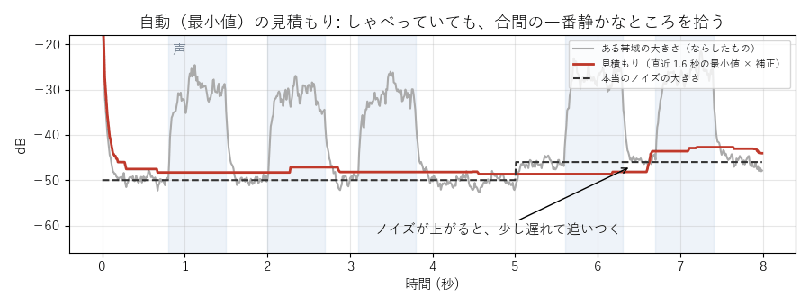

[目次](../README.md) ｜ 前: [ノイズとデノイズの地図](01-overview.md) ｜ 次: [帯域分割式とくし形フィルタ](03-band-split.md)

# ノイズの見積もり

デノイズは、まず「ノイズがどれくらいの大きさか」を、帯域ごとに知る必要があります。しかし、マイクに入るのは「声＋ノイズ」で、ノイズだけを直接は測れません。そこで、いくつかの工夫で見積もります。

VoiChanAlgoBox の「ノイズの見積もり」は、帯域分割式、くし形、FFT の方式で使います。初期値は「自動（音量の判定）」です。AI の方式と WebRTC NS は、自分でノイズを見積もるので使いません（灰色になります）。

## 自動（最小値）

話している間にも、言葉と言葉の間や、声の弱い帯域には、ノイズだけの瞬間があります。そこで、帯域ごとの大きさ（50ms でならす）の、直近の「最小値を探す長さ」（初期値 1.6 秒）の中の**最小値**をノイズとみなします（**最小値統計**、Martin 2001）。

- 灰色はある帯域の大きさ、赤が見積もり、点線が本当のノイズの大きさです。
- 声がある区間（青）でも、見積もりはノイズの高さに保たれます。
- ノイズが急に大きくなると（5 秒）、最小値が更新されるまで少し遅れて追いつきます。

最小値は平均より小さく出るので、補正の倍率をかけます。VoiChanAlgoBox では、起動したときに白色雑音を通して、平均と最小値の比を実際に測って倍率にしています（探す長さの 7 通りで測り、その間は補間します）。

弱点もあります。同じ母音をずっと伸ばし続けると、声をノイズとみなしてしまいます（探す長さより長く途切れない音）。

「最小値を探す長さ」（0.8〜3.2 秒）は、この弱点とノイズの変化への追いつきの釣り合いを決めます。長くすると、話し続けても声を削りにくくなりますが、ノイズが大きくなったときに追いつくのが遅くなります。短くすると、その逆です。

## 声かどうかを見分けて、声のない間だけ更新する

最小値の弱点をなくすには、「今は声か、ノイズだけか」を見分けて、ノイズだけの間だけ見積もりを更新すればよさそうです。見分け方によって、3 つの方法があります。

| 見積もり | 見分け方 | 話し続けたとき | ノイズが大きくなったとき |
|---|---|---|---|
| 自動（音量の判定）（初期値） | 全体の音量の大きさ | 小さい声をノイズと取り違えることがある | しきい値を超えて大きくなると、追いつかない（しきい値を上げて合わせ直す） |
| 自動（Gerkmann の声の推定） | 帯域ごとの音量の比から、声がある確率を計算（統計モデル） | 少し削れる | 速く追いつく |
| 自動（RNNoise の声の判定） | AI が「声らしい音か」を判定 | ほとんど削れない | 速く追いつく |

### 自動（音量の判定）（初期値）

全体の音量が、今の見積もりより「判定のしきい値」（初期値 6dB）以上大きければ声とみなし、声のない間だけ見積もりを更新します（約 0.4 秒でならす。声の後 0.1 秒は、語尾を覚えないように更新しない）。

- 一番わかりやすい方法ですが、音量しか見ないので、声とノイズの音量が近いと見分けられません。しきい値を上げると小さい声をノイズとして覚え、下げるとノイズの小さな揺れも声とみなして、更新が止まりがちになります。
- 「声」とみなしている間は、どれだけ続いても見積もりを動かしません。そのため、話し続けたり、「あー」と伸ばし続けたりしても、声をノイズとして覚えません。
- 代わりに、ノイズがしきい値を超えるほど大きくなる（エアコンが動き出す、マイクのゲインを上げる、など）と、話していない間も「声」とみなされ、見積もりが止まったままになります。そのときは、「判定のしきい値」を一時的に上げてください。新しいノイズが「声なし」に入ると見積もりが追いつくので、追いついたら元の値に戻します。しきい値より小さい変化や、すぐ止む音には、そのまま追いつきます。

### 自動（Gerkmann の声の推定）

区画ごとに「今の大きさが、ノイズの見積もりの何倍か」から、声がある確率を計算し、声がなさそうな分だけ見積もりを更新します（Gerkmann・Hendriks 2012）。区画ごとに見るので、低い帯域で声が鳴っていても、高い帯域のノイズは追いかけられます。音量の判定を、区画ごと・確率つきにした形です。

- 確率は、「声があるときは、ノイズよりこれだけ大きい」という仮定から計算します。これが「声の SNR の仮定」（初期値は論文の 15dB）です。下げると、少し大きいだけの音も声とみなすので、話し続けても声を削りにくくなりますが、ノイズの変化には追いつきにくくなります。上げると、その逆です。
- 声がずっとありそうな区画でも、見積もりが止まったままにならないよう、ごく少しずつは更新します（論文の手順）。そのため、途切れずに話し続けると、見積もりが少しずつ声に寄っていきます。

### 自動（RNNoise の声の判定）

AI のデノイズ「RNNoise」には、声かどうかを判定する部分（**VAD**、Voice Activity Detection）があります。これを別に動かし、「声なし」と判定された間の大きさだけで、ノイズの見積もりを更新します（約 0.4 秒でならす）。

- 判定は「声らしさ」を学習した AI がするので、話し続けても、声をノイズと取り違えにくいです。最小値や Gerkmann は、途切れずに話し続けると、声の弱い部分をノイズとみなして見積もりが上がり、声を削ることがあります。
- 判定は 10ms ごとで、少し遅れて出ます。そのため、分析した大きさを 60ms 遅らせておき、その前後がずっと「声なし」と確かめられたものだけを使います。声の出だしを、ノイズとして覚えないようにするためです。
- 「声とみなす確率」（初期値 50%）は、RNNoise が出す声である確率の区切りです。RNNoise の確率はほとんど 0% か 100% に寄るので、はっきりした声やノイズでは、変えても差はほとんど出ません。息づかいや小声、遠くの話し声のような、確率が中間に出る音の扱いが変わります。
- まだ一度も「声なし」を確かめられていないとき（いきなり話し始めたとき）は、最小値の見積もりを使います。
- 「声あり」が 4 秒以上続くと、最小値の見積もりの方が小さい帯域だけ、そちらへゆっくり下げます。上げる向きには動かしません（声を削らない側に倒す）。
- RNNoise を別に動かす分、処理が少し重くなります（遅延は増えません）。

## 学習

「ノイズを学習（2 秒）」のボタンを押して、2 秒間黙っている間のノイズを覚え、その値を使います（RX の Learn に相当）。

- 話し声に引きずられないので、見積もりが正確です。
- ノイズが変わっても追いかけません（エアコンを入れた、など）。
- 覚えた値は設定と一緒に保存されます。

## 学習＋自動

学習した値から始めて、その後は音量の判定 / Gerkmann の声の推定 / RNNoise の声の判定で追いかけます。最初から正確で、変化にも追いつけます。自動だけだと、話し始めてすぐは見積もりが落ち着いていないので、その間の下がり方が少し弱くなります。

## 残響の抑制

部屋の響き（残響）も、声の後に残るノイズのように聞こえます。「残響の抑制」をオンにすると、少し前（80ms 前）の音の大きさから、今残っているはずの響きを見積もり（残響の長さ RT60 から計算）、ノイズの見積もりに足して一緒に下げます（Lebart ら 2001 の形）。

## 聞きどころ

- モニターの「ノイズの見積もりを表示」をオンにして、緑の点線（見積もり）が、話していないときの入力のスペクトルに重なるかを見てください。
- 「あー」と長く伸ばし続けると、自動（最小値）では声が少しずつ削れていく様子が聞けます。学習や、自動（RNNoise の声の判定）では起きにくいです。
- 扇風機を途中で付けるなどしてノイズを変え、自動と学習の追いかけ方の違いを聞いてください。
