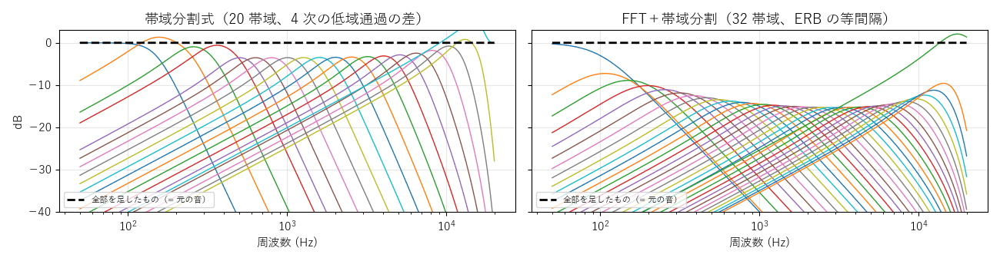
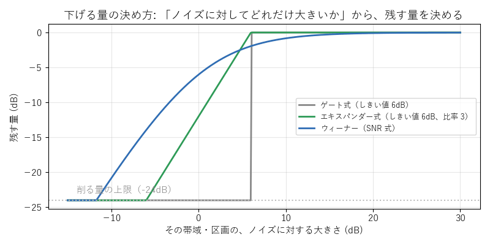
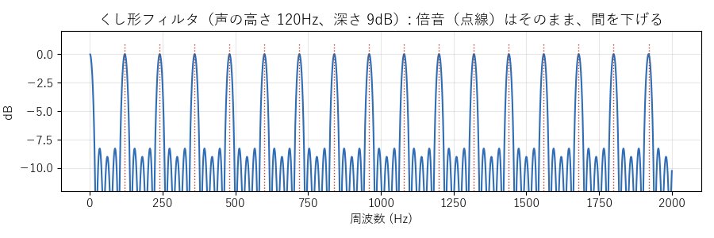

[目次](../README.md) ｜ 前: [ノイズの見積もり](02-noise-estimation.md) ｜ 次: [FFT の方式](04-fft.md)

# 帯域分割式とくし形フィルタ

## 帯域分割式

### 仕組み

声をフィルタで 20 の帯域に分け、帯域ごとに下げる量を決めて、足し合わせて戻します。FFT のように窓の分の音をためないので、遅延は 0 です。

左が帯域分割式の 20 帯域です（150Hz〜16kHz。500Hz より上は 1/3 オクターブずつ）。帯域は「低域通過フィルタの差」で作るので、すべての帯域を同じ倍率のまま足すと、元の音にぴったり戻ります（黒い点線）。右は、後で出てくる「FFT＋帯域分割」の 32 帯域です。

### 下げる量の決め方

帯域の大きさがノイズの何倍か（SNR）から、残す量を決めます。

| 決め方 | 内容 | つまみ |
|---|---|---|
| ゲート式 | しきい値より小さい帯域を、一気に下げる | しきい値 |
| エキスパンダー式 | しきい値より下を、比率に応じてなだらかに下げる。初期値の比率 3 ではゲート式より浅い（深くするには比率を上げる） | しきい値、比率 |
| SNR 式（初期値） | ノイズの割合の分だけ下げる（ウィーナー型）。一番自然 | 強さ |

下げる量は、アタック（声が来て開くまでの速さ、初期値 10ms）とリリース（声が止んで下げきるまでの速さ、初期値 100ms）でなめらかに動かします。速すぎると音が揺れ、遅すぎると語頭が欠けたり、語尾の後にノイズが残ったりします。

### 特徴

- 遅延 0 で、計算も軽い方式です。
- 帯域の幅（1/3 オクターブ）の中で、声とノイズを分けられません。声のある帯域では、その帯域のノイズも一緒に残ります。

## くし形フィルタ＋帯域分割

### 仕組み

声の倍音は、声の高さの整数倍にきれいに並び、その間にはノイズしかありません。そこで、帯域分割式の後に、倍音の間だけを下げる**くし形フィルタ**をかけます。

ピッチ検出で声の周期 T を求め、「元の音 − T ずつずらした 4 つの平均」を、深さ（初期値 9dB）に応じて引きます。周期の整数倍の周波数（倍音）は、ずらしても形が同じなので残り、その間の周波数が下がります。かけるのは 4kHz より下の有声音のときだけです。

### 特徴

- 声のある帯域でも、倍音の間のノイズを下げられます。
- ピッチ検出を誤ると、倍音の位置がずれて、声そのものが削れます（検出の方式はデノイズのタブで選べます）。
- 無声音（子音や息）や無音の区間では働かないので、違いは有声音の区間だけです。

## この実装のつまみ

| つまみ | 初期値 | 内容 |
|---|---|---|
| 下げる量の決め方 | SNR 式 | ゲート式 / エキスパンダー式 / SNR 式（詳細の表示だけ） |
| 強さ（SNR 式） | 6dB | ノイズを何倍に見積もるか。大きいほど強く下げる |
| しきい値・比率 | 6dB・3 | ゲート式・エキスパンダー式（詳細の表示だけ） |
| アタック・リリース | 10ms・100ms | 下げる量の動きの速さ |
| くし形の深さ | 9dB | 倍音の間を下げる量 |

## 聞きどころ

- 決め方をゲート式にすると、ノイズが開いたり閉じたりする「パタパタ」した感じが聞けます。SNR 式はなめらかです。
- リリースを 10ms にすると音が揺れ、1000ms にすると語尾の後にノイズが尾を引きます。
- くし形フィルタで、ピッチ検出を自己相関にして話すと、検出の誤りで声が削れる瞬間があります。
