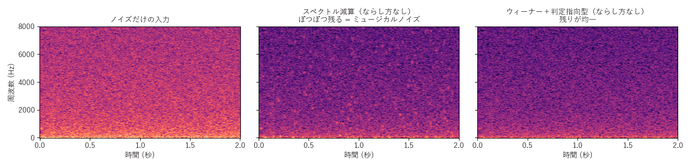

[目次](../README.md) ｜ 前: [帯域分割式とくし形フィルタ](03-band-split.md) ｜ 次: [遅延 0 でかける工夫](05-zero-latency.md)

# FFT の方式

## 仕組み

FFT で声を細かい周波数の区画（ビン）に分け、区画ごとに下げる量を決めて、逆 FFT で戻します。帯域分割式より細かく（窓 512 で約 94Hz ごと）分けられるので、声の倍音と倍音の間のノイズを分けて下げられます。

窓の長さの分の音をためてから処理するので、窓の長さ（512 で約 11ms）だけ遅れます。窓は 256 / 512 / 1024 から選べます（長いほど周波数は細かく、遅延は大きい）。

## ミュージカルノイズ

FFT のデノイズの一番の悩みは、**ミュージカルノイズ**です。ノイズの大きさは区画ごと・時間ごとにばらつくので、たまたま大きく出た区画だけが下げられずに残ります。それが、ぽつぽつと鳴る「ピロピロ」「キラキラ」した音として聞こえます。

- **中（スペクトル減算）**: 残ったノイズが、点のようにばらばらに残っています。これがミュージカルノイズです。
- **右（ウィーナー＋判定指向型）**: 残りが均一で、ただの小さな「サー」になっています。

## 下げる量の決め方（10 通り）

初期値は log-MMSE です。上位どうしの違いは小さいので、「下げる量の決め方」は詳細の表示だけに出します。

| 決め方 | 内容 |
|---|---|
| スペクトル減算 | 今の大きさからノイズの大きさを引く。一番素朴で、ミュージカルノイズが出る |
| ウィーナー | 判定指向型で SNR を見積もり、ノイズの割合だけ下げる。前の結果も使って時間方向になめらかにするので、ピロピロしない |
| MMSE-STSA | 声の大きさの期待値が一番正しくなるように下げる（Ephraim・Malah）。ウィーナーより控えめで、声を傷めにくい |
| log-MMSE（初期値） | MMSE-STSA と同じ考え方で、大きさを対数で考えた形。耳の感じ方に近い。ウィーナーよりノイズの下がりが少し浅い代わりに、声の削れが少ない |
| ウィーナー＋倍音の再生（HRNR） | ウィーナーの結果を一度波形に戻して半波整流し、細った倍音を作り直してから、もう一度決める |
| ウィーナー＋倍音の保護 | ピッチ検出で求めた倍音の位置だけ、下げる量をゆるめる（窓 1024 向け） |
| 過剰減算（Berouti） | SNR が低いフレームほど多めに引き、ピロピロを減らす |
| 帯域ごとの減算（Kamath-Loizou） | 過剰減算を、4 つの帯域ごとに強さを変えて行う |
| ウィーナー＋2 段階（TSNR） | ウィーナーの結果から SNR を求め直し、語頭の欠けを取り戻す |
| 聴覚のマスキング（Virag） | 声に隠れて聞こえないノイズは残し、声を傷めない。ピロピロは残る |

**判定指向型**の SNR の見積もりは、「直前に決めた結果から求めた SNR」と「今の大きさから求めた SNR」を、前者を重く（0.98）して混ぜる方法です。ノイズのばらつきで SNR が跳ねにくくなり、ミュージカルノイズが大きく減ります。代わりに、急な変化（語頭）への反応が少し遅れます。

## 下げる量のならし方

下げる量を、さらにならしてミュージカルノイズを減らします（初期値は時間）。

| ならし方 | 内容 |
|---|---|
| なし | ならさない |
| 時間（初期値） | 変化をアタック・リリースの速さでゆっくりにする。強いと語頭が欠ける |
| 周波数 | 前後の区画（ならす幅、初期値 200Hz）で平均する。強いと倍音の間が残る |
| ケプストラム | 下げる量のケプストラムで、声色と倍音の並びは残し、細かい揺れだけならす（Breithaupt ら 2007） |

ウィーナーは、ならさなくてもピロピロがほとんど出ません。スペクトル減算にならし方を重ねると、効果がよく分かります。

## 声のありそうさで調整

区画ごとに「声がありそうな確率」を求め、声がなさそうな区画ほど強く下げます（OM-LSA の考え方）。

| 選択 | 内容 |
|---|---|
| オフ（初期値） | 調整しない |
| 半々で固定 | 声がない確率を、前もって 50% とみなす |
| 自動（Cohen） | 声がない確率を、周りの区画の SNR から区画ごとに見積もる |

## 残ったノイズの音色をそろえる

「コンフォートノイズ」とも呼ばれます。下げきったノイズの残りが、区画ごとにばらばらの大きさで残ると、不自然に聞こえます。そこで、いったん深く下げてから、足りない分を「見積もったノイズの形」の雑音で足して、残りの音色と大きさを一定にそろえます（FFT の方式だけ）。

## この実装のつまみ

| つまみ | 初期値 | 内容 |
|---|---|---|
| 下げる量の決め方 | log-MMSE | 上の 10 通り（詳細の表示だけ） |
| 強さ | 6dB | ノイズを何倍に見積もるか |
| FFT の窓の長さ | 512 | 256 / 512 / 1024 |
| ならし方 | 時間 | なし / 時間 / 周波数 / ケプストラム |
| 声のありそうさで調整 | オフ | オフ / 半々で固定 / 自動（Cohen） |
| 残ったノイズの音色をそろえる | オフ | FFT の方式だけ |

## 聞きどころ

- 方式を FFT、決め方をスペクトル減算、ならし方をなしにすると、ミュージカルノイズがはっきり聞けます。ならし方を時間、ケプストラムと変えると、減っていきます。
- 削る量の上限を 30dB にすると、決め方による違い（ウィーナーは強く下げる、MMSE 系は控えめ、など）が分かりやすくなります。
- 聴覚のマスキングは、声は傷めませんが、ピロピロが残ります。「何を優先するか」の違いを聞いてください。
