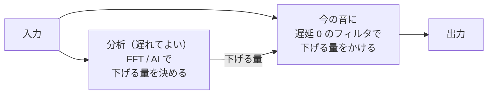

[目次](../README.md) ｜ 前: [FFT の方式](04-fft.md) ｜ 次: [WebRTC NS と AI の方式](06-webrtc-ai.md)

# 遅延 0 でかける工夫

FFT の方式は細かく下げられますが、窓の分だけ遅れます。AI の方式は、さらに大きく遅れます。デノイズの遅れはボイチェンの遅れと足し合わされるので、VoiChanAlgoBox では「決めるのは遅れて、かけるのは今」という工夫で、遅延 0 の版を用意しています。

## 考え方: 分析と適用を分ける

音そのものは、遅延のないフィルタだけを通します。分析は横で行い、決まった「下げる量」をフィルタに渡します。分析の分だけ、下げる量の更新は少し遅れますが、音は遅れません。代わりに、声の出だし（語頭）では、まだ「ノイズしかない」と判断していた古い下げる量がかかり、語頭が少し欠けやすくなります。

## FFT＋FIR（初期値）

FFT で区画ごとに決めた下げる量から、同じ周波数特性を持つ**最小位相の FIR フィルタ**を作り、今の音にかけます。

- 分析は、窓の 1/8 ずつずらして細かく行います。窓は、今に近い側を重くした非対称の形にして、反応を速めています。
- 下げる量をケプストラムで折り返して、最小位相（遅れの一番少ない形）のフィルタにします。
- 新しいフィルタへは、16 サンプルごとに少しずつ係数を混ぜて移ります（切り替わりの雑音を出さないため）。

FFT の決め方・ならし方・声のありそうさなど、FFT の設定はすべて使えます。

## ＋帯域分割（サイドブランチ）

FFT や AI で決めた下げる量を、帯域ごとの量にまとめて、帯域分割のフィルタ（遅延 0）で今の音にかけます。

| 方式 | 決めるもの | かける帯域 |
|---|---|---|
| FFT＋帯域分割 | FFT の区画ごとの下げる量を、帯域ごとにまとめる | 32 帯域（ERB の等間隔、100Hz〜16kHz） |
| WebRTC NS＋帯域分割 | WebRTC NS が出した音と、入れた音の大きさの比 | 同上 |
| RNNoise＋帯域分割 | RNNoise が出した音と、入れた音の大きさの比 | 同上 |
| DeepFilterNet＋帯域分割 | DeepFilterNet が出した音と、入れた音の大きさの比 | 同上 |

AI の方式は、AI が出した音と、それに入れた音（AI の中の遅れの分だけ前の音）を帯域ごとに比べ、その比を下げる量にします。こうすると、AI の判断を、遅延 0 で今の音にかけられます。このように本線とは別の枝で判断する作りを、**サイドブランチ方式**と呼ぶことがあります。

帯域の分け方は [帯域分割式とくし形フィルタ](03-band-split.md) の図の右側です。2 次のフィルタの差で作るので、帯域どうしの重なりは大きめですが、全部を足すと元の音にぴったり戻ります。

### 代償

- 帯域の幅の中で、倍音と倍音の間だけを下げるような細かさは出せません。帯域全体を下げるので、ノイズの多い帯域では倍音も一緒に下がります。
- AI の判断は 20〜40ms 遅れてくるので、語頭が欠けやすくなります。

### 立ち上がりの保護（FFT＋帯域分割）

語頭の欠けを減らすため、FFT＋帯域分割には「立ち上がりの保護」があります（初期値オン）。遅延 0 の帯域の速い音量が、ノイズより 10dB 以上、かつゆっくりの音量より 3dB 以上急に大きくなったら、その帯域を 30ms 開けます。

## 聞きどころ

- FFT と FFT＋FIR を切り替えて、遅延の表示（約 11ms → 0ms）と、語頭の聞こえ方を比べてください。
- RNNoise と RNNoise＋帯域分割を比べると、遅延 0 にした代わりに、ノイズの消え方が粗くなり、語頭が欠けやすくなるのが分かります。
- FFT＋帯域分割で立ち上がりの保護をオフにすると、語頭の欠けが増えます。
