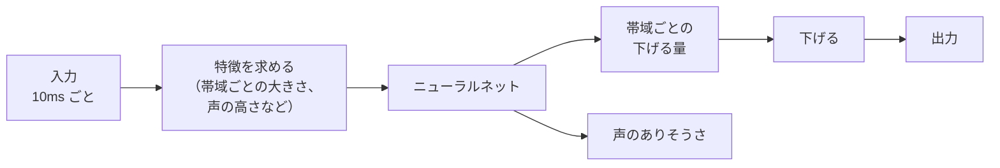

[目次](../README.md) ｜ 前: [遅延 0 でかける工夫](05-zero-latency.md) ｜ 次: [前後の段](07-related-stages.md)

# WebRTC NS と AI の方式

この 3 つは、ノイズの見積もりも下げる量の決め方も、方式の中で自分で行います。そのため、VoiChanAlgoBox の「ノイズの見積もり」と「残響の抑制」は使いません（灰色になります）。「削る量の上限」は、方式の出力に、同じだけ遅らせた元の音を混ぜて実現しています。

どれも 48kHz で動く作りなので、44.1kHz のときは中で 48kHz に変換して処理します（遅延が約 1ms 増えます）。

## WebRTC NS

**WebRTC** は、ブラウザのビデオ通話などで使われるリアルタイム通信の技術で、その中にノイズ抑制（Noise Suppression）が入っています。AI ではない、古典的な信号処理の組み合わせです。

- 周波数ごとに、声とノイズを見分ける複数の特徴（スペクトルの平らさ、形の違いなど）から、声のありそうさを求めます。
- ノイズを見積もり、ウィーナーフィルタに近い形で下げます。
- 下げる強さは 6 / 12 / 18 / 21dB の段階から、削る量の上限以上で一番近いものを使います。

VoiChanAlgoBox では、WebRTC のライブラリ（freedesktop の webrtc-audio-processing）から、ノイズ抑制に必要なファイルだけを取り出して組み込んでいます。遅延は約 17ms です。

## RNNoise

**RNNoise**（Xiph.Org、BSD ライセンス）は、小さなニューラルネット（再帰型ニューラルネット、RNN）が、帯域ごとに下げる量を決める方式です。

- 人の耳の感じ方に合わせた 22 の帯域ごとに、下げる量を決めます。下げる量の決め方を、大量の声とノイズのデータから学習しています。
- 倍音の間のノイズは、声の高さに合わせたくし形のフィルタで下げます。
- 遅延は約 30ms（10ms ごとの処理と、1 回分の先読み）。
- 息の音も「声ではないもの」として大きく下げます。息っぽさを残したい場合は、ほかの方式の方が向いています。

## DeepFilterNet

**DeepFilterNet**（MIT / Apache-2.0）は、より新しく大きなニューラルネットの方式です。

- 粗い帯域ごとの下げる量に加えて、低い周波数では、ニューラルネットが過去の数フレームを組み合わせる細かいフィルタ（**ディープフィルタリング**）を作り、倍音の構造まで復元します。
- ノイズを強く消しながら、声の質を保ちやすい方式です。
- 遅延は約 40ms。モデルを「低遅延（DeepFilterNet3 LL）」にすると約 20ms になりますが、ノイズの減り方は弱くなります。
- 「後段のフィルタ」をオンにすると、残ったノイズをさらに少し下げます。

VoiChanAlgoBox では、推論エンジン tract を使う Rust のラッパーを作り、プラグインの中に静的に組み込んでいます（利用者が別に DLL を用意する必要はありません）。

## 比べてみると

| 方式 | 遅延 | 特徴 |
|---|---|---|
| WebRTC NS | 約 17ms | 控えめに下げる。声は自然 |
| RNNoise | 約 30ms | 強く下げる。息も消す |
| DeepFilterNet | 約 40ms | 強く下げつつ、声の質を保つ。負荷は大きめ |

どれも遅延 0 の「＋帯域分割」版があります（[遅延 0 でかける工夫](05-zero-latency.md)）。

## 聞きどころ

- 3 つを切り替えて、ノイズの消え方、声の自然さ、遅延の違いを聞き比べてください。
- 息を多めに混ぜて話すと、RNNoise が息を消す様子が聞けます。
- DeepFilterNet のモデルを標準と低遅延で比べると、遅延とノイズの減り方の釣り合いが分かります。
