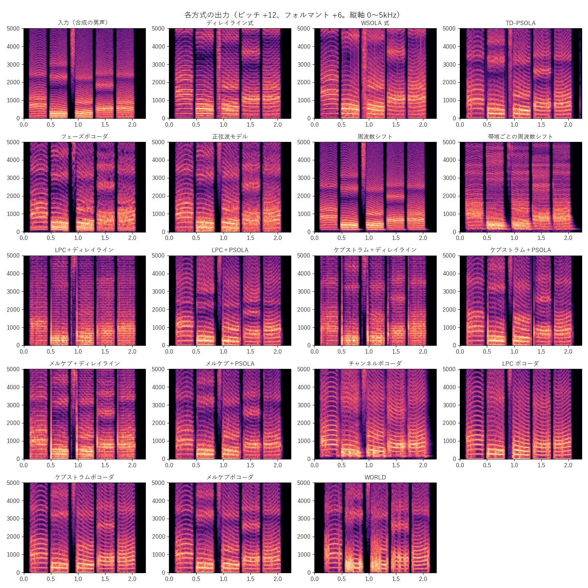

[目次](../README.md) ｜ 前: [遅延](../basics/07-latency.md) ｜ 次: [ディレイライン式と WSOLA 式](02-delay-line-wsola.md)

# ボイチェンの方式の地図

VoiChanAlgoBox には、声の高さと声色を変える 18 の方式があります。どれも「ピッチ・フォルマント系」の方式で、AI で別人の声に変換する方式（RVC など）は含みません。

## 分類

| 分類 | 方式 | 遅延の目安 | フォルマントを別に動かせるか | ピッチ検出 |
|---|---|---|---|---|
| 時間領域（波形を並べ直す） | ディレイライン式 | 約15ms | × | 不要 |
| | WSOLA 式 | 約20ms | × | 不要 |
| | TD-PSOLA | 約25ms | ○ | 使う |
| 周波数領域（周波数の成分を動かす） | フェーズボコーダ | 約16ms | ○（フォルマント処理） | 不要 |
| | 正弦波モデル | 約16ms | ○（フォルマント処理） | 不要 |
| 周波数シフト | 周波数シフト | 約0ms | × | 不要 |
| | 帯域ごとの周波数シフト | 約1ms | ○（フォルマント処理） | 不要 |
| 声色と声帯の音に分ける | LPC / ケプストラム / メルケプ ＋ディレイライン | 約15ms | ○ | 不要 |
| | LPC / ケプストラム / メルケプ ＋PSOLA | 約25ms | ○ | 使う |
| ボコーダ（声帯の音を作り直す） | チャンネルボコーダ | 約5ms | ○ | 使う |
| | LPC / ケプストラム / メルケプ ボコーダ | 約16ms | ○ | 使う |
| 分析合成 | WORLD | 約84ms | ○ | 自前（DIO / Harvest） |

遅延の目安は、初期設定のときの値です（方式の選択欄にも出ています）。

「声色と声帯の音に分ける方式」と「ボコーダ」の 9 方式は、「声色の求め方」と「声帯の音の高さの変え方」の 3 × 3 の組み合わせです。

| 声帯の音の変え方 ＼ 声色の求め方 | LPC | ケプストラム | メルケプストラム |
|---|---|---|---|
| 早回し（ディレイライン） | LPC＋ディレイライン | ケプストラム＋ディレイライン | メルケプ＋ディレイライン |
| 1 周期ずつ並べ直す（PSOLA） | LPC＋PSOLA | ケプストラム＋PSOLA | メルケプ＋PSOLA |
| 作り直す（ボコーダ） | LPC ボコーダ | ケプストラムボコーダ | メルケプボコーダ |

同じ列（声色の求め方）や同じ行（声帯の音の変え方）で聞き比べると、どちらの違いが音に効いているかが分かります。

## 出力の比べ方

下の図は、同じ合成の男声（「あいうえお」）を、ピッチ +12、フォルマント +6 で各方式に通した結果です。

見るところは次の 3 つです。

- **倍音の線の間隔**: 入力の 2 倍に広がっていれば、ピッチが正しく上がっています。
- **フォルマントの帯の位置**: 入力より上に動いていれば、声色も変わっています。ディレイライン式や周波数シフトは、方式の性質でフォルマントを別に動かせません。
- **線の乱れ**: 倍音の線がにじんだり、縦の筋や横の帯が入ったりしているところは、雑音や響きの崩れとして聞こえます。

## 選び方の目安

| 重視すること | 候補 |
|---|---|
| 遅延の小ささ | 周波数シフト（声は不自然）、帯域ごとの周波数シフト、チャンネルボコーダ |
| 遅延・負荷・品質の釣り合い | TD-PSOLA（初期値） |
| 品質 | WORLD（遅延は大きい） |
| 仕組みの違いを学ぶ | 3 × 3 の組み合わせを、行や列ごとに聞き比べる |

## 聞きどころ

- 同じ文を録音して、vcab_render の `--all` で全方式を一括で書き出すと、同じ声で聞き比べられます（README の「開発用の WAV 処理ツール」）。
- フォルマントのつまみを 0 にしてピッチだけ上げると、方式ごとの「ピッチの変え方」の違いだけを聞けます。
