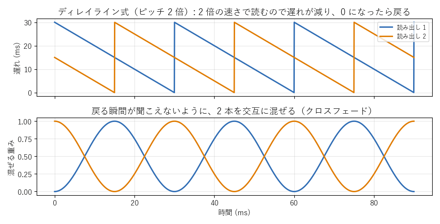
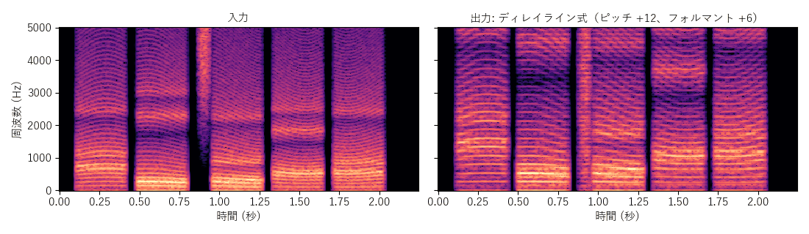
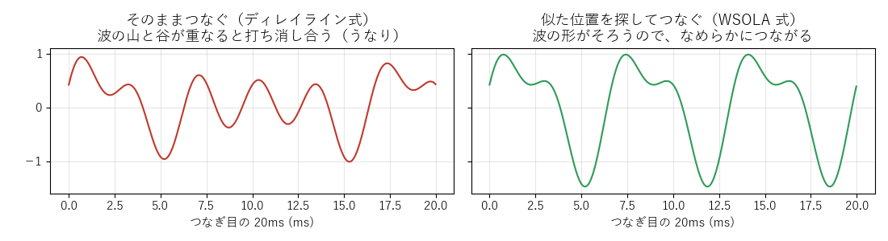
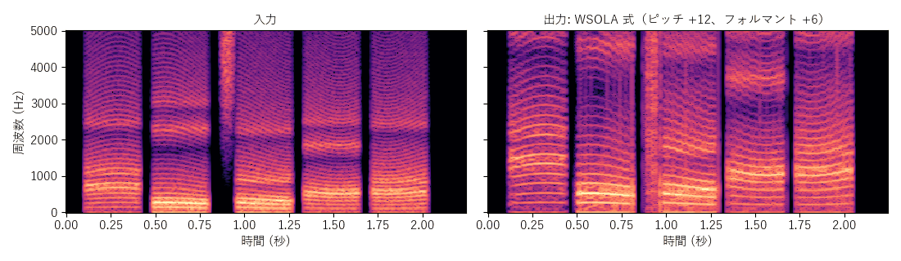

[目次](../README.md) ｜ 前: [方式の地図](01-overview.md) ｜ 次: [TD-PSOLA](03-td-psola.md)

# ディレイライン式と WSOLA 式

どちらも「早回し」で声の高さを変える、一番シンプルな方式です。フォルマントはピッチと一緒に動き、別には動かせません。

## ディレイライン式

### 仕組み

入ってきた音を、短いバッファ（**ディレイライン**、初期値 30ms）に書き込み続けます。それを、ピッチの倍率に合わせた速さで読み出します。ピッチ 2 倍なら、2 倍の速さで読みます。

速く読むと、読み出す位置が書き込む位置に追いついてしまいます。そこで、追いついたら 1 窓分だけ後ろに戻ります。戻る瞬間の段差が聞こえないように、読み出し位置を 2 つ用意して、交互に混ぜます（**クロスフェード**）。

- **上**: 2 本の読み出し位置の遅れ。2 倍の速さで読むので遅れがどんどん減り、0 になると窓の長さ（30ms）まで戻ります。2 本は半周期ずらしてあります。
- **下**: 混ぜる重み。片方が戻る瞬間には、その重みが 0 になっています。

### 特徴

- 計算はとても軽く、ピッチ検出も要りません。
- 2 本を混ぜるとき、声の波形の山と谷が重なると打ち消し合い、「うなり」（ゴロゴロした揺れ）が出ます。窓の長さを変えると、うなりの感じが変わります。
- 遅れは 0〜窓の長さの間を行き来し、平均は窓の半分です。

倍音の間隔は 2 倍に広がっていますが、フォルマントの帯も上に動き（早回しの声）、横に細かい縞（うなり）が入っています。

## WSOLA 式

### 仕組み

WSOLA（Waveform Similarity Overlap-Add）は、ディレイライン式の「戻る位置」を工夫したものです。決まった位置に戻るのではなく、戻る先の近く（探す範囲、初期値 10ms）で、今の波形と一番よく似ている位置を探して、そこにつなぎます。

- **左（そのままつなぐ）**: 波の山と谷がずれたまま混ぜると、打ち消し合って音が痩せます。
- **右（似た位置を探してつなぐ）**: 波形の形がそろうので、なめらかにつながります。

### 特徴

- ディレイライン式より、うなりがかなり減ります。
- 似た位置を探す分だけ計算が増え、遅れも少し増えます（約 20ms）。
- フォルマントはピッチと一緒に動きます（早回しの声のまま）。

## この実装のつまみ

| つまみ | 初期値 | 内容 |
|---|---|---|
| 窓の長さ（ディレイライン式） | 30ms | 戻る間隔。短いとうなりが速く、長いと遅れが増える |
| 窓の長さ（WSOLA 式） | 40ms | つなぐ断片の長さ |
| 探す範囲（WSOLA 式） | 10ms | 似た位置を探す幅 |

## 聞きどころ

- ディレイライン式と WSOLA 式を切り替えて、伸ばした母音（「あー」）のうなりの違いを聞いてください。
- ディレイライン式の窓の長さを 10ms と 100ms にして比べると、うなりの速さと、遅れの感じが変わります。
