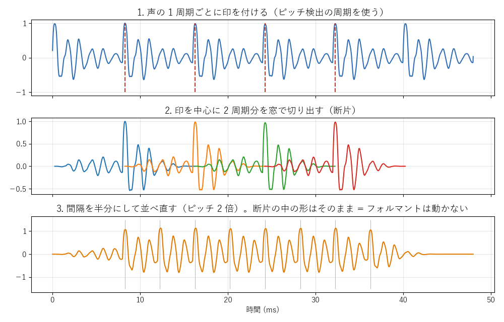
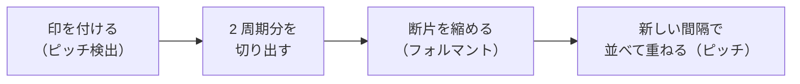
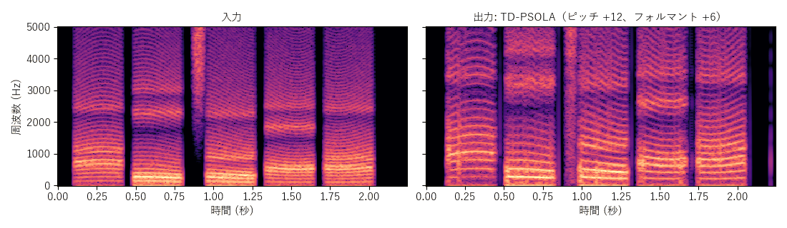

[目次](../README.md) ｜ 前: [ディレイライン式と WSOLA 式](02-delay-line-wsola.md) ｜ 次: [フェーズボコーダと正弦波モデル](04-phase-vocoder-sinusoidal.md)

# TD-PSOLA

TD-PSOLA（Time-Domain Pitch-Synchronous Overlap-Add）は、声の 1 周期ごとに波形を切り出して、間隔を変えて並べ直す方式です。VoiChanAlgoBox の初期値の方式です。

## 仕組み

1. **印を付ける**: ピッチ検出で求めた周期をもとに、声の 1 周期ごとに印（**ピッチマーク**）を付けます。
2. **切り出す**: 印を中心に、2 周期分を山形の窓で切り出します。この断片 1 つが、声帯の 1 回の振動と、それに対する声道の響きです。
3. **並べ直す**: 断片を、新しい周期の間隔で並べて重ねます。間隔を半分にすれば、声の高さは 2 倍になります。

断片の中の形はそのままなので、声道の響き（フォルマント）は動きません。声の高さだけが変わります。

## フォルマントを動かす

フォルマントを動かすには、断片そのものを時間方向に伸び縮みさせます。断片を縮めると、その中の響きの周波数が上がり、フォルマントが上がります。

## 無声音の扱い

子音や息のように周期のない音（無声音）では、印を付けられません。ピッチ検出が無声音と判定した区間では、周期に合わせた切り出しをやめ、決まった間隔で切り出して並べます。VoiChanAlgoBox では、有声と無声の断片を別々の流れで並べ、有声らしさに合わせてなめらかに混ぜて、切り替わりの段差を抑えています。

## この実装のつまみ

| つまみ | 初期値 | 内容 |
|---|---|---|
| 印付けの方式 | 波形の重なり | 波形の重なり: 前の印の周りと一番よく重なる位置に印を付ける。声門閉鎖点: 声帯が閉じる瞬間（LPC の残差の山）に印を付ける（遅延が約 15ms 増える） |
| ピッチ検出の方式・探す範囲 | YIN、80〜400Hz | [ピッチ検出](../basics/06-pitch-detection.md) |

声門閉鎖点は雑音のない声では正確ですが、雑音があると印の位置がぶれやすく、多くの場合は波形の重なりの方が安定します。聞き比べのために選べるようにしています。

## 特徴

- 遅延、負荷、品質の釣り合いがよく、ピッチとフォルマントを別々に動かせます。
- 遅延は、探す範囲の下限の 2 周期分（80Hz で約 25ms）。
- ピッチ検出を間違えると（特にオクターブの誤り）、断片の間隔がずれて、ガラガラした音になります。
- ピッチを大きく下げると、断片の間に隙間ができ、響きが薄くなります。

倍音の間隔が 2 倍に広がり、フォルマントの帯も上に動いています。

## 聞きどころ

- フォルマントを 0 にして、ピッチだけ +12 にすると、声色を保ったまま声の高さが上がることを確かめられます。
- ピッチ検出を自己相関にして低い声で話すと、オクターブの誤りでガラガラした音が混ざる瞬間があります。
- 印付けの方式を切り替えて、響きの違いを聞いてください。違いが小さいこと自体も、知っておくと役に立ちます。
