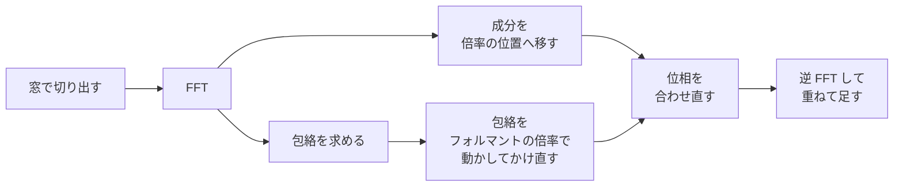
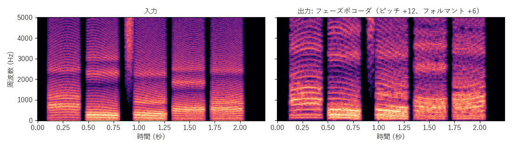
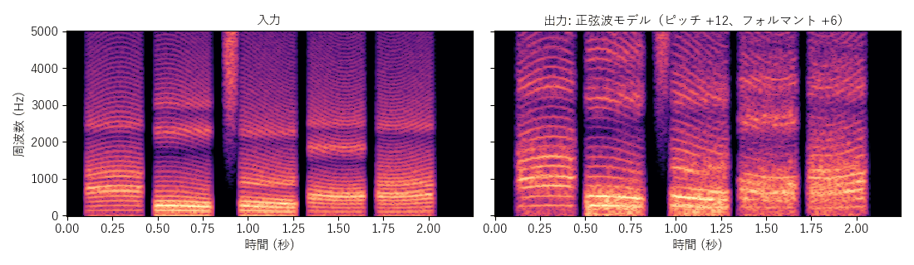

[目次](../README.md) ｜ 前: [TD-PSOLA](03-td-psola.md) ｜ 次: [周波数シフト](05-frequency-shift.md)

# フェーズボコーダと正弦波モデル

どちらも、FFT で声を周波数の成分に分け、その成分の周波数を動かしてから、声に戻す方式です。ピッチ検出は要りません。

## フェーズボコーダ

### 仕組み

1. 声を窓で切り出して FFT し、周波数ごとの成分（ビン）に分けます。
2. 各ビンの成分を、ピッチの倍率に合わせた周波数のビンへ移します（ピッチ 2 倍なら、200Hz の成分を 400Hz へ）。
3. 位相（波のタイミング）を、新しい周波数で次の窓と自然につながるように計算し直します。
4. 逆 FFT して、窓を重ねて足し、声に戻します。

成分をそのまま移すだけでは、声色（包絡）も一緒に動きます。そこで、先に包絡を求めておき（**フォルマント処理**）、移した後の成分を「元の包絡」で割って「フォルマントの倍率で動かした包絡」を掛け直します。こうして、ピッチとフォルマントを別々に動かせます。

### 位相ロック

フェーズボコーダの弱点は、倍音の周りのビンの位相がばらばらになり、こもった響き（**フェージネス**）が出ることです。**位相ロック**は、倍音の山の周りのビンの位相を、山の頂点のビンに合わせてまとめて動かし、響きのこもりを減らします（初期値オン）。

### 特徴

- 窓の長さ（初期値 1024）で、遅延（窓の 3/4、1024 で約 16ms）と周波数の細かさが決まります。512 は遅れが少ないが低い声の倍音が粗くなり、2048 は細かいが遅れが増えます。
- 声の出だしなど急な変化では、窓の長さの分だけ音がにじみます。

## 正弦波モデル

### 仕組み

正弦波モデル（McAulay-Quatieri）は、FFT で倍音の山を 1 本ずつ見つけて、その周波数と大きさを追いかけ、正弦波で鳴らし直す方式です。

1. FFT のスペクトルから、山（倍音）を見つけます（最大 80 本）。
2. 前の窓の山とつないで、1 本の正弦波の流れとして追いかけます。
3. 周波数をピッチの倍率で動かし、大きさは「動かした包絡」から決め直して（フォルマント）、正弦波を作って足します。

### 雑音成分（正弦波＋雑音モデル）

息やサ行の子音のように、正弦波で表せない部分もあります。**雑音成分**をオンにすると、元のスペクトルから鳴らした正弦波の分を引いた残りを、ランダムな位相の雑音として鳴らします（SMS、正弦波＋雑音モデル）。「ヒューヒュー」「水っぽい」音が減ります（初期値オン）。

### 特徴

- 倍音の 1 本 1 本を扱うので、ピッチを変えても倍音の並びがきれいに保たれます。
- 山の見つけ損ないや、つなぎ間違いがあると、正弦波がちぎれて「ピロピロ」した音になります。

## フォルマント処理

フェーズボコーダと正弦波モデルの「フォルマント処理」では、包絡の求め方を選べます（[声色の形（包絡）の求め方](../basics/05-envelope.md)）。

| 選択 | 内容 |
|---|---|
| なし | フォルマントはピッチと一緒に動く（早回しの声） |
| ケプストラム | なだらかで、山が低め |
| LPC 包絡 | 山が鋭い |
| True Envelope（初期値） | 倍音の頂点をなぞる |

## この実装のつまみ

| つまみ | 初期値 | 内容 |
|---|---|---|
| FFT の窓の長さ | 1024 | 512 / 1024 / 2048。窓は 1/4 ずつずらす |
| 位相ロック（フェーズボコーダ） | オン | 倍音の周りの位相をまとめて動かす |
| 正弦波の数の上限（正弦波モデル） | 80 | 鳴らし直す倍音の数 |
| 雑音成分（正弦波モデル） | オン | 正弦波で表せない息や子音を雑音で鳴らす |
| フォルマント処理 | True Envelope | 包絡の求め方 |

## 聞きどころ

- フェーズボコーダで位相ロックをオフにすると、こもったような、お風呂で話したような響きになります。
- 窓の長さを 512 と 2048 で比べると、語頭のにじみと、低い声の響きの違いが聞けます。
- 正弦波モデルで雑音成分をオフにすると、サ行や息の音が不自然になります。
