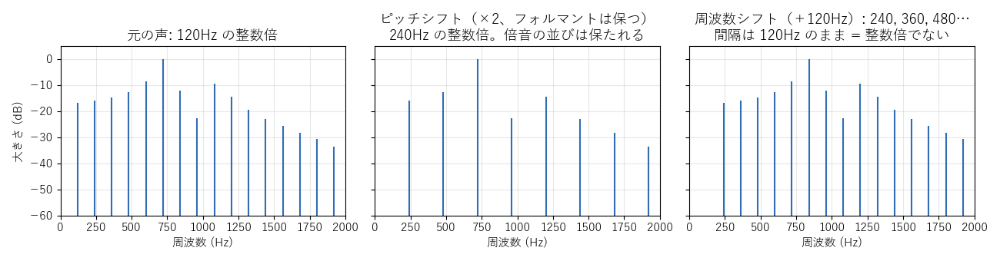
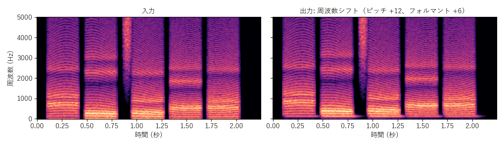
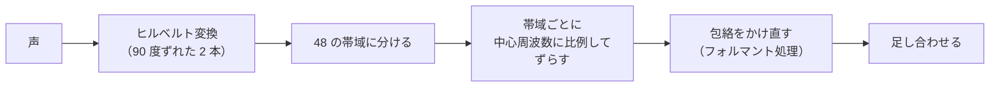
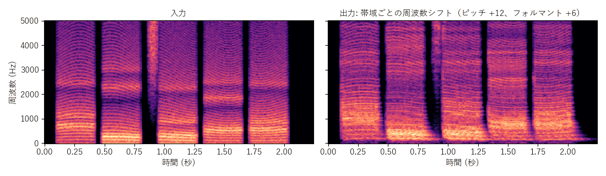

[目次](../README.md) ｜ 前: [フェーズボコーダと正弦波モデル](04-phase-vocoder-sinusoidal.md) ｜ 次: [声色と声帯の音に分ける方式](06-source-filter.md)

# 周波数シフト

## ピッチシフトと周波数シフトの違い

ピッチシフトは、すべての周波数を同じ**倍率**で動かします。周波数シフトは、すべての周波数を同じ**Hz**だけずらします。

- **ピッチシフト（×2）**: 120, 240, 360… が 240, 480, 720… になります。倍音は 240Hz の整数倍のまま並び、声として自然に聞こえます。
- **周波数シフト（＋120Hz）**: 120, 240, 360… が 240, 360, 480… になります。間隔は 120Hz のまま、240Hz の整数倍ではなくなります。倍音の並びが崩れるので、金属的な、ロボットのような声になります。

周波数シフトは、ピッチシフトとの違いを体験するための方式です。

## 周波数シフト

### 仕組み

声の信号から、90 度位相のずれた信号を作り（**ヒルベルト変換**）、2 本を組み合わせて、すべての成分を同じ Hz だけずらします。VoiChanAlgoBox では、90 度の位相差を作る全域通過フィルタの組（Niemitalo の係数）で近似しています。

ずらす量は、ピッチのつまみと**基準の周波数**（初期値 120Hz）から決めます。

> ずらす量 = 基準の周波数 ×（ピッチの倍率 − 1）

ピッチ +12（2 倍）、基準 120Hz なら、120Hz ずらします。基準の周波数の音だけが、ピッチのつまみどおりの高さになります。

### 特徴

- 遅延はほぼ 0 です。
- フォルマントは別に動かせません（声色も同じ Hz だけずれる）。

## 帯域ごとの周波数シフト

### 仕組み

声を数十の帯域（初期値 48）に分け、帯域ごとに「中心周波数 ×（倍率 − 1）」Hz だけずらします。高い帯域ほど大きくずらすので、全体としてはピッチシフトに近づきます。

帯域の中では、すべての成分が同じ Hz だけずれるので、倍音の並びが少し崩れます。帯域を細かくするほど崩れは減ります。

### フォルマント処理

ずらした後に、元の声から取り出した包絡を帯域ごとにかけ直して、フォルマントを独立に動かします。

| 選択 | 内容 |
|---|---|
| なし | フォルマントはピッチと一緒に動く |
| 帯域の大きさ（初期値） | 帯域ごとの大きさをそのまま包絡とみなす。遅れがない |
| ケプストラム / LPC 包絡 / True Envelope | FFT で包絡を求める。形は細かいが、包絡の変化が少し遅れる |

### 特徴

- 遅延が数 ms と小さいまま、ピッチとフォルマントを別々に動かせる唯一の方式です。
- 帯域の中の倍音のずれで、声の高さが少し揺れて聞こえることがあります。
- 低い帯域ほど、帯域に分けるフィルタの遅れが大きくなります。

## 聞きどころ

- 周波数シフトで、基準の周波数を自分の声の高さに近づけたり遠ざけたりすると、金属的な響きの強さが変わります。
- 帯域ごとの周波数シフトで、帯域の数を 8 と 100 にして比べてください。帯域が少ないと周波数シフトに近い響きになります。
