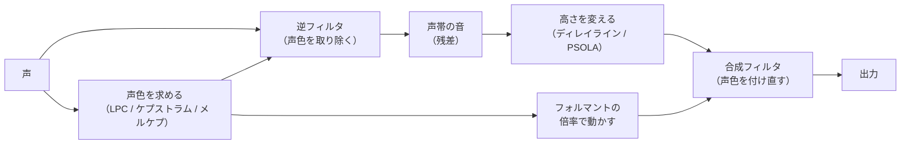
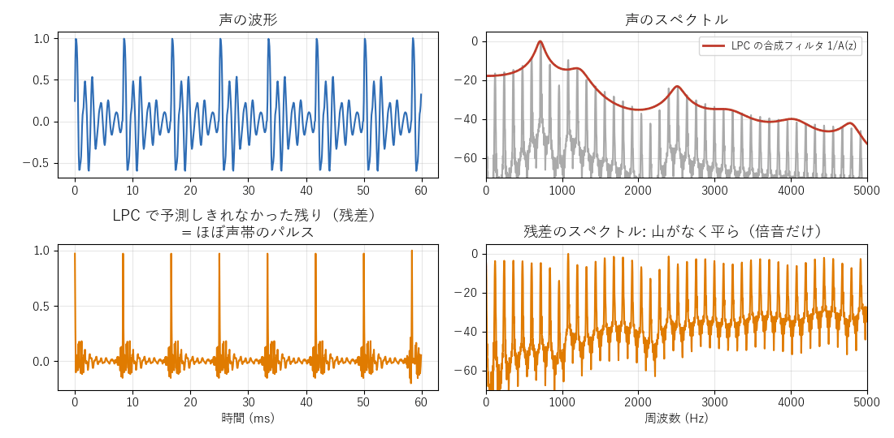
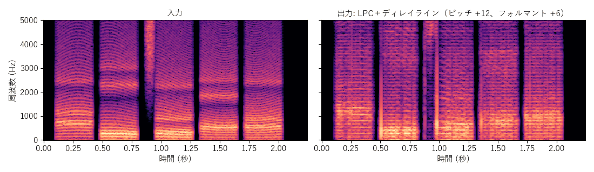
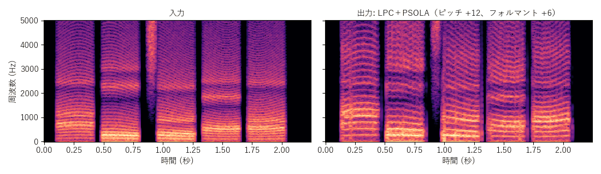
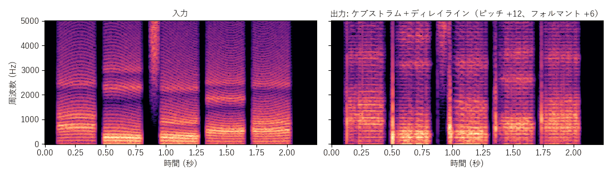
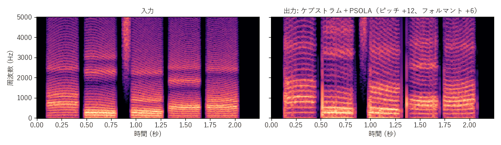
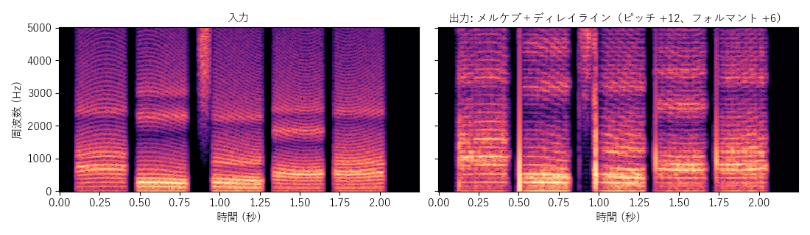
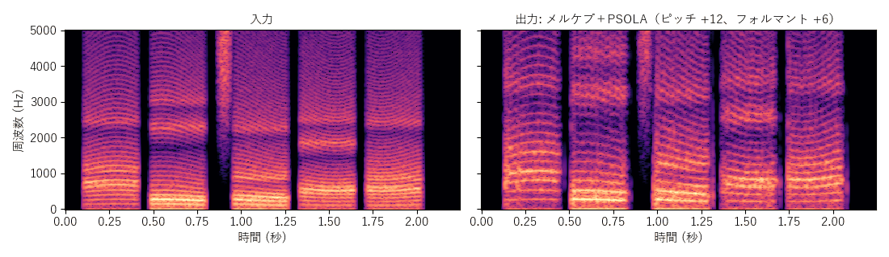

[目次](../README.md) ｜ 前: [周波数シフト](05-frequency-shift.md) ｜ 次: [ボコーダ](07-vocoders.md)

# 声色と声帯の音に分ける方式

[声の仕組み](../basics/03-voice.md) のソース・フィルタモデルを、そのまま使う方式です。声を「声帯の音」と「口と喉のフィルタ」に分け、声帯の音の高さだけを変えてから、フィルタを通し直します。

## 仕組み

1. 声から声色（包絡）を求めます。
2. 声色の逆のフィルタを通して、声色を取り除きます。残るのは、ほぼ声帯のパルスの並び（**残差**）です。
3. 残差の高さを、ディレイライン式か PSOLA で変えます。
4. フォルマントの倍率で動かした声色のフィルタを通して、声に戻します。

- **左上**: 声の波形。1 周期の中に、声道の響きの細かい揺れがあります。
- **左下**: LPC の逆フィルタを通した残差。響きが取り除かれ、周期ごとの鋭いパルスが残ります。
- **右上**: 声のスペクトルと、LPC で求めた声道のフィルタの形（赤）。
- **右下**: 残差のスペクトル。山（フォルマント）がなくなり、倍音がほぼ平らに並びます。

声帯の音は、声色を含まないので、早回しやパルスの並べ直しで高さを変えても、声色は変わりません。声色は、別に動かしたフィルタで付け直すので、ピッチとフォルマントを別々に動かせます。

## 3 × 2 の 6 方式

| 声帯の音の変え方 ＼ 声色の求め方 | LPC | ケプストラム | メルケプストラム |
|---|---|---|---|
| ディレイライン（早回し） | LPC＋ディレイライン | ケプストラム＋ディレイライン | メルケプ＋ディレイライン |
| PSOLA（1 周期ずつ並べ直す） | LPC＋PSOLA | ケプストラム＋PSOLA | メルケプ＋PSOLA |

### 声色の求め方による違い

- **LPC**: 5ms ごとに、直近 25ms の声から求めます。山の鋭い声色になります。フォルマントを動かすときは、声色の形を周波数方向に伸び縮みさせてから、LPC を求め直します。LPC の改善（帯域拡張・係数補間・高域強調）のスイッチがあります。
- **ケプストラム**: ケプストラムで求めたなだらかな声色を、同じ形のフィルタ（格子型）で表します（48kHz で 60 次）。LPC より山がなだらかです。
- **メルケプストラム**: 周波数の軸を耳の感じ方に合わせて曲げた声色を、MLSA フィルタで付け直します。低い周波数の形を細かく表せます。

### 声帯の音の変え方による違い

- **ディレイライン**: ピッチ検出が要らず軽いですが、[ディレイライン式](02-delay-line-wsola.md) と同じうなりが出ます。残差はパルスの並びなので、うなりが元の声よりも目立ちやすくなります。
- **PSOLA**: ピッチ検出を使って、パルスを 1 つずつ並べ直します。うなりがなく、きれいです。ピッチ検出は、残差ではなく元の声で行います。

## 音量の暴れ止め

声の出だしで、まだ平らになりきっていない残差が合成フィルタに入ると、大きな音に跳ね上がることがあります。VoiChanAlgoBox では、出力が入力より 6dB 以上大きくなったら下げる「暴れ止め」を入れています。

## 出力

ディレイラインの方式は、倍音の線の上に細かい縦の縞（うなり）が入ります。PSOLA の方式は、倍音の線がきれいです。

## この実装のつまみ

| つまみ | 初期値 | 内容 |
|---|---|---|
| LPC の次数（LPC の方式） | 28 | 声色の形の細かさ |
| 帯域拡張・係数補間・高域強調（LPC の方式） | すべてオン | LPC の音質の定番の対策 |
| 窓の長さ（ディレイライン） | 30ms | ディレイライン式と同じ |
| ピッチ検出（PSOLA） | YIN | TD-PSOLA と同じ |

ケプストラムとメルケプの方式は、LPC の改善のスイッチを使いません（係数のなめらかなつなぎは、いつも使います）。

## 聞きどころ

- LPC＋PSOLA、ケプストラム＋PSOLA、メルケプ＋PSOLA を切り替えて、声色の求め方の違いを聞いてください（フォルマント +6 のとき）。
- LPC＋ディレイラインと LPC＋PSOLA を比べると、声帯の音の変え方の違い（うなりの有無）が聞けます。
- ピッチ検出を SIFT にした LPC＋PSOLA は「LPC だけでできた」方式に、ケプストラム法にしたケプストラム＋PSOLA は「ケプストラムだけでできた」方式になります。
- LPC の方式で、LPC の改善のスイッチを 1 つずつオフにすると、それぞれの効果が聞けます。
