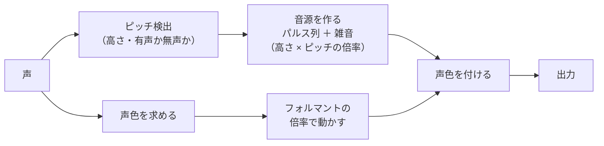
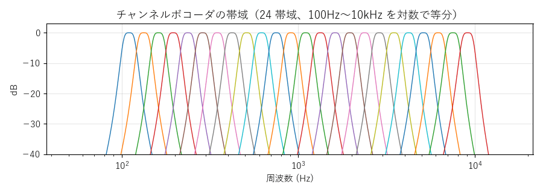
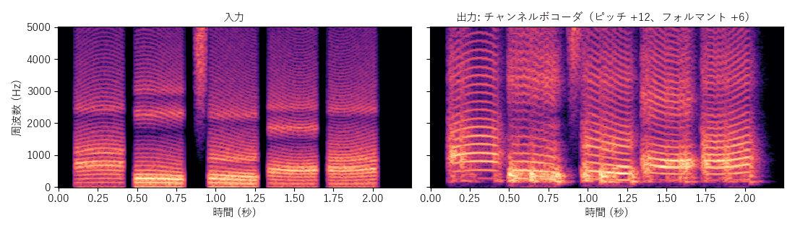
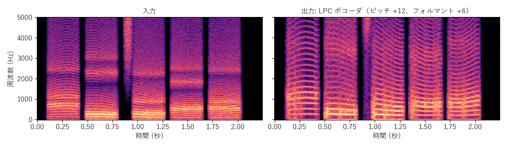
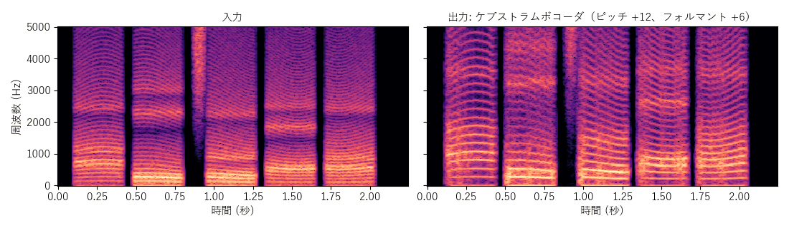
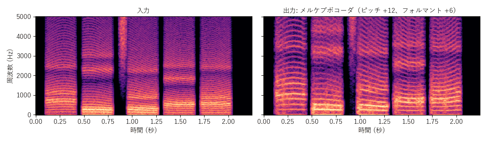
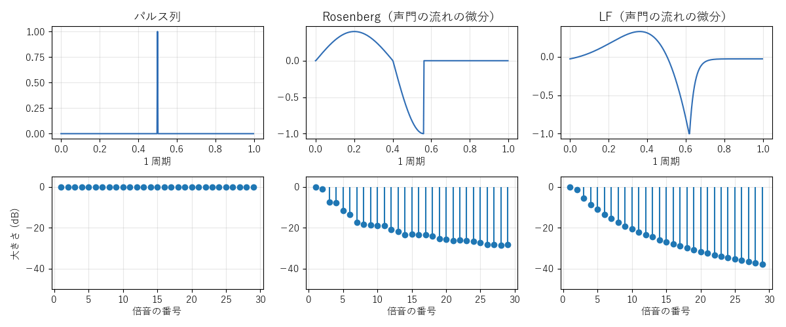

[目次](../README.md) ｜ 前: [声色と声帯の音に分ける方式](06-source-filter.md) ｜ 次: [WORLD](08-world.md)

# ボコーダ

ボコーダは、元の声の声帯の音を使わず、**声帯の音を作り直す**方式です。ピッチ検出で求めた高さのパルス列（と雑音）を新しく作り、それに元の声の声色を付けます。声帯の音を作るときに好きな高さにできるので、ピッチの変更は簡単です。

## チャンネルボコーダ

### 仕組み

一番古典的なボコーダです。

1. 声を、100Hz〜10kHz を対数で等分した帯域（初期値 24）に分けます。
2. 帯域ごとの大きさ（10ms でならす）を測ります。これが粗い声色の形です。
3. 音源（有声音ならのこぎり波、無声音なら雑音）を同じ帯域に分け、帯域ごとに「声の大きさ ÷ 音源の大きさ」をかけてから足し合わせます。

フォルマントは、測った帯域の大きさを、合成するときにどの帯域に割り当てるかをずらして動かします。

### 特徴

- 遅延が約 5ms と小さく、ピッチとフォルマントを別々に動かせます。
- 声色の細かさは帯域の数で決まるので、いわゆる「ロボット声」「ボコーダ声」の質感になります。帯域を増やすと、元の声に近づきます。

## LPC・ケプストラム・メルケプ ボコーダ

[声色と声帯の音に分ける方式](06-source-filter.md) と同じく、LPC・ケプストラム・メルケプストラムで声色を求めます。違いは、声帯の音として残差を使わず、パルス列と雑音で作り直すことです。大きさは、その時刻の声の大きさ（LPC の予測の誤差など）から付けます。

- 残差の細かい揺れ（声のかすれや、ざらつき）がなくなるので、なめらかですが、機械的な声になりやすくなります。
- 遅延は約 16ms です。

## 混合励振

単純なボコーダは、有声音ならパルス列、無声音なら雑音、と切り替えるだけです。実際の声は、有声音でも高い帯域には息の雑音が混ざっています。そのため、単純な切り替えでは「ブー」というブザーのような音になりがちです。

**混合励振**（MELP と同じ考え方）は、音源を 5 つの帯域（500 / 1000 / 2000 / 4000Hz で区切る）に分け、帯域ごとにパルス列と雑音を混ぜる割合を決めます。割合は、元の声のその帯域が、どれだけ周期的か（1 周期ずらしたときの相関）で決めます。ボコーダの 4 方式で使え、初期値はオンです。

## 声帯の波形

作り直す声帯の音の、1 周期の形を選べます（ボコーダの 4 方式。初期値はパルス列）。

| 形 | 内容 |
|---|---|
| パルス列 | 鋭い山だけ。倍音がすべて同じ大きさ。ブザーのような響きになりやすい |
| Rosenberg | 声帯を流れる空気の量をまねた、丸い山（の微分）。高い倍音が小さく、やわらかい響き |
| LF | 閉じる瞬間が鋭く、閉じた後の戻りも含む（Liljencrants-Fant のモデル）。パルス列に近く、太め |

声色の包絡は、もともと声帯の音の傾き（高い倍音ほど小さい）を含んでいます。そのため VoiChanAlgoBox では、2 番目から上の倍音の傾きはパルス列と同じ平らにそろえ、1 番目の倍音の強さと波形の形の違いだけを残しています。

## この実装のつまみ

| つまみ | 初期値 | 内容 |
|---|---|---|
| 帯域の数（チャンネルボコーダ） | 24 | 4〜48 |
| 混合励振 | オン | 帯域ごとにパルス列と雑音を混ぜる |
| 声帯の波形 | パルス列 | パルス列 / Rosenberg / LF |
| ピッチ検出 | YIN | 音源の高さを決める |

## 聞きどころ

- チャンネルボコーダの帯域の数を 4、12、48 と変えて、ロボット声から元の声に近づく様子を聞いてください。
- 混合励振をオフにすると、ブザーのような響きと、子音への切り替わりの不自然さが目立ちます。
- 声帯の波形を切り替えると、響きのやわらかさが変わります（違いは主に低い倍音）。
