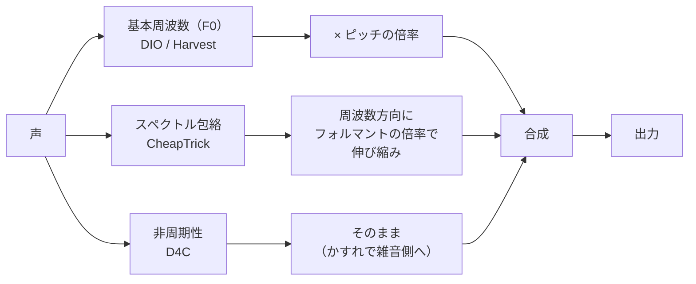
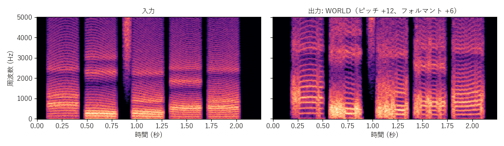

[目次](../README.md) ｜ 前: [ボコーダ](07-vocoders.md) ｜ 次: [フォルマントの動かし方と抑揚](09-formant-warp.md)

# WORLD

WORLD は、森勢将雅氏による音声分析合成システムです（[mmorise/World](https://github.com/mmorise/World)、修正 BSD ライセンス）。声を 3 つの要素に分解し、それぞれを加工してから、声を作り直します。VoiChanAlgoBox では、WORLD のソースをそのまま組み込み、リアルタイムでつなぐ部分を作っています。

## 仕組み

| 要素 | 内容 | 求め方 |
|---|---|---|
| 基本周波数（F0） | 声の高さ | DIO（速い）か Harvest（正確） |
| スペクトル包絡 | 声色（フォルマント） | CheapTrick: 声の高さに合わせた窓で、倍音の影響を除いた包絡を求める |
| 非周期性 | 周波数ごとの「息っぽさ」（雑音の割合） | D4C |

ピッチは F0 を倍率倍し、フォルマントはスペクトル包絡を周波数方向に伸び縮みさせて動かします。非周期性で、帯域ごとにパルスと雑音の混ぜ方を決めるので、ボコーダの混合励振をさらに細かくしたような音源になります。

## リアルタイムで動かす工夫

WORLD は、もともと録音全体をまとめて分析する作りです。VoiChanAlgoBox では、次のようにして少しずつ処理しています。

- 20ms（4 フレーム）ごとに、前に 120ms、後ろに 40ms の余裕を付けた区間を切り出して分析し、真ん中の 4 フレームだけを使います。
- 合成は、WORLD のリアルタイム用の合成器を使います。
- 分析と合成は重いので、音の処理とは別のスレッドで計算します（間に合わなければ無音）。WAV を書き出すとき（vcab_render や DAW の書き出し）は、その場で計算するので、結果が毎回同じになります。
- Harvest はそのままでは重すぎるので、少しずつ計算できる形（HarvestStream）に組み直しています。

## 特徴

- 声の高さの精度が高く、ピッチを大きく変えても崩れにくい、品質の高い方式です。
- 遅延は約 84ms（DIO）と大きく、Harvest にするとさらに約 40ms 増えます。モニターしながら話すには遅れが気になります。
- 負荷も大きめです。

## この実装のつまみ

| つまみ | 初期値 | 内容 |
|---|---|---|
| ピッチ検出の方式 | DIO | DIO / Harvest |
| かすれ | 0% | 非周期性を雑音の側に寄せて、息っぽい声にする |
| 探す範囲 | 80〜400Hz | ピッチ検出の探す範囲を、DIO / Harvest にも使う |

## 聞きどころ

- WORLD と TD-PSOLA を、同じピッチとフォルマントで聞き比べてください。品質の差と、遅延の差の両方を体験できます。
- かすれを上げると、ささやき声に近づきます。
- DIO と Harvest を切り替えると、声の高さの追い方（特に子音の前後）と遅延が変わります。
