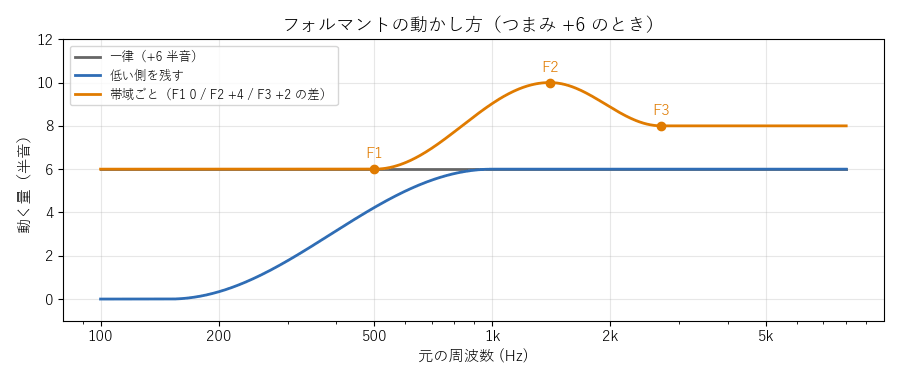

[目次](../README.md) ｜ 前: [WORLD](08-world.md) ｜ 次: [デノイズ編](../denoise/01-overview.md)

# フォルマントの動かし方と抑揚

フォルマントを分けられる方式では、フォルマントの「動かし方」を選べます（表示のモードが詳細のとき）。また、ピッチ検出を使う方式では、声の抑揚を強められます。

## フォルマントの動かし方

横軸が元の周波数、縦軸がその周波数を何半音動かすかです（フォルマントのつまみ +6 のとき）。

| 動かし方 | 内容 |
|---|---|
| 一律（初期値） | すべての周波数を同じ倍率で動かす |
| 低い側を残す | 1kHz より上は一律。そこから下は低いほど動かさず、150Hz 以下は動かさない |
| 帯域ごと | 固定の目印（500 / 1400 / 2700Hz）に、F1・F2・F3 ごとの差を置き、間をなめらかにつなぐ |
| フォルマントごと | 目印を、声から追いかけた F1・F2・F3 の位置に置く |

### 低い側を残す

一律に動かすと、声の一番低い成分（胸の響き）まで上がり、声が細く聞こえることがあります。低い側を残すと、胸の響きを保ったまま、声色の主な山（F1 より上）を動かせます。

### 帯域ごと・フォルマントごと

実際の声の違いでは、F1・F2・F3 の上がり方は同じとは限りません。そこで、F1・F2・F3 を別々の量だけ動かせるようにしたのがこの 2 つです。差は、ボイチェンのタブの「フォルマントの動く量」のグラフの点を上下にドラッグして変えます。

- **帯域ごと**: 目印が固定なので、母音によって F2 が目印から外れると（「お」の F2 は約 850Hz で、目印の 1400Hz から遠い）、狙いどおりに動きません。
- **フォルマントごと**: 声から F1〜F3 を 5ms ごとに追いかけて（LPC の根から求める）、目印をその位置に置きます。外れる母音でも狙いに近づきます。追いかけている間は、グラフの点が塗りつぶしになります。無声音や小さい音では追いかけず、目印は固定の位置に戻ります。

チャンネルボコーダと WORLD では、フォルマントごとは帯域ごとと同じに扱います。

## 抑揚の強調

ピッチ検出を使う方式では、「抑揚」（0〜100%、初期値 0%）で、声の高さの上下の幅を広げられます（表示のモードが詳細のとき）。

最近約 2 秒の声の高さの平均を基準にし、そこからのずれを広げます。100% で、ずれが 2 倍になります。たとえば、平均から +2 半音高く話した部分は、+4 半音になります。ピッチ検出の誤りで急に跳んだ値（5 半音以上）は無視し、変化は約 20ms でなめらかにします。

女声は男声より抑揚が大きいと言われます。話し方で抑揚を付けるのが難しいときに、補助として使えます。

## 聞きどころ

- フォルマント +6 で「一律」と「低い側を残す」を比べると、声の太さが変わります。
- 「フォルマントごと」で F2 だけ +4 にして「あいうえお」と言い、グラフの点が母音に合わせて動く様子を見てください。
- 抑揚を 50% にして文を読むと、アニメの演技のような抑揚になります。
